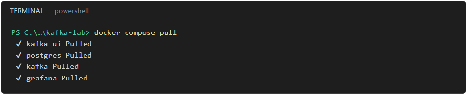
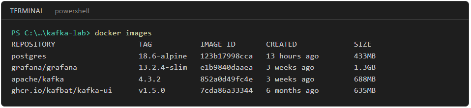

# Real-Time Data Streaming with Apache Kafka (Node.js)

*Move, process and react to live sensor data with Apache Kafka and Node.js. A hands-on 2-day course.*

You build one system across the two days: a river level monitoring pipeline. Six river stations across Malaysia send a water level (`paras_air`) and rainfall (`hujan`) reading every second. On Day 1 you run Kafka in Docker and explore it with tools only: no code to write. On Day 2 you write a few short Node.js programs that produce readings, react to them with flood alerts and save them to a database, and you watch it all live in Grafana.

`river stations (simulator) → Kafka → alert.js → flood alerts → notifier.js · database · Grafana dashboard`

**Acronyms used throughout:** **IoT** = Internet of Things · **SQL** = Structured Query Language · **CLI** = command-line interface · **UI** = user interface · **JSON** = JavaScript Object Notation · **KRaft** = Kafka Raft, Kafka's built-in way of managing the cluster (it replaced ZooKeeper) · **SMS** = Short Message Service · **JPS** = Jabatan Pengairan dan Saliran · **LTS** = Long-Term Support

## The 2 days

**[Day 1 — Kafka Fundamentals: Explore with Tools](day1.md)**
Why streaming and the core ideas, then Kafka in Docker explored with the Kafka UI and the Kafka CLI while a simulator streams live river data. Topics, keys, consumer groups, lag, replay, retention and compaction, then headers and timestamps, finding any message, topic housekeeping and adding partitions to a live topic, all by hand.

**[Day 2 — Code: Produce, React to Events, Dashboard](day2.md)**
A producer and a consumer in Node.js, keys and ordering, delivery guarantees, then two event-driven programs: one raises flood alerts, one reacts to them, and a writer that saves every reading to PostgreSQL. Ends with a live Grafana dashboard and the full pipeline running end to end.

## The running example

| Station | River | Location | Negeri | Waspada (alert) | Amaran (warning) | Bahaya (danger) |
|---|---|---|---|---|---|---|
| KLT01 | Sungai Kelantan | Kuala Krai | Kelantan | 21.0 m | 23.0 m | 25.0 m |
| PHG01 | Sungai Pahang | Temerloh | Pahang | 32.0 m | 33.5 m | 35.0 m |
| TRG01 | Sungai Terengganu | Kuala Berang | Terengganu | 12.0 m | 13.0 m | 14.0 m |
| SGR01 | Sungai Selangor | Rasa | Selangor | 26.5 m | 27.5 m | 28.5 m |
| KDH01 | Sungai Muda | Kuala Ketil | Kedah | 7.5 m | 8.5 m | 9.5 m |
| JHR01 | Sungai Johor | Kota Tinggi | Johor | 4.0 m | 4.5 m | 5.0 m |

Each reading is a small JSON message:

```json
{ "stesen": "KLT01", "masa": "2026-11-10T01:15:00.000Z", "paras_air": 21.43, "hujan": 38.5 }
```

> **Note:** The levels follow the same four stages JPS uses (Normal, Waspada, Amaran, Bahaya), but the numbers are sample values for training. They are not official JPS station levels.

## The whole setup at a glance

| | What | Where |
|---|---|---|
| **4 containers** | Kafka (one broker), Kafka UI, Grafana, PostgreSQL | `docker-compose.yml` |
| **4 producer files** | `kafka.js` (connection), `stations.js` (station list), `producer.js`, `simulator.js` | Node.js |
| **4 consumer files** | `consumer.js`, `alert.js`, `notifier.js`, `db-writer.js` | Node.js |
| **2 tools** | Kafka UI (`http://localhost:8085`) and the Kafka CLI (already inside the Kafka container) | Browser, terminal |
| **1 dashboard** | Grafana (`http://localhost:3000`), reading Kafka directly | Browser |

## How to read this

- Every topic has a **Goal**, the **steps**, and a **Checkpoint ✅**. Don't move on until the checkpoint is true.
- Topics marked **(concept)** are short explanations with no hands-on build.
- **Try it** sections ask you to change something and see what happens. **Break it on purpose** shows you the real error before you meet it at work.
- Topics go in order. Each one builds on the one before.
- **Code steps:** when a step says *Create `producer.js`*, use the copy button on the code block and paste it into a new file. You don't need to type it. Read the table under it, then run it.
- Stuck or behind? Every finished file is in [`code/`](code/). Copy it into your `kafka-lab` folder and carry on.
- **Screenshots** show what you should see at that step. Terminal screenshots show the real output of the command; only the prompt is shortened to `PS C:\…\kafka-lab>`, so yours shows your own folder path.

## The one rule of this course

**Assume every message can arrive twice, late, or broken.** Kafka is very good at not losing data. Making sure your program copes with what arrives is your job.

## Course learning outcomes

By the end of the course you can:

1. Explain real-time streaming and where Kafka fits compared with batch processing and message queues.
2. Explain the core Kafka concepts: topics, partitions, offsets and consumer groups.
3. Run a local Kafka cluster using Docker.
4. Build producers and consumers in Node.js with KafkaJS.
5. Stream and process IoT sensor data, including filtering and threshold alerts.
6. Integrate Kafka with a database and external systems.
7. Build a simple real-time dashboard from Kafka events.
8. Apply basic reliability, retention and monitoring practices.

## Before the course

**Your laptop:** 8 GB of RAM at the very least, 8 GB of free disk space, and **local administrator rights** (Docker Desktop needs them to install). On Windows, Docker Desktop also needs **WSL 2** (Windows Subsystem for Linux) and virtualisation turned on.

**Software:**

| Software | Version | Check with |
|---|---|---|
| Docker Desktop | latest | `docker --version` and `docker compose version` |
| Node.js | 26 LTS (24 LTS also works) | `node --version` |
| Visual Studio Code | latest | — |

**Download the course images** (about 3 GB, so do this on a fast connection):

1. Get this repository: on GitHub click **Code → Download ZIP** and unzip it, or run `git clone`.
2. Start Docker Desktop.
3. Open PowerShell (Windows) or Terminal (macOS/Linux) in the repository's `code` folder and run:

```powershell
docker compose pull
```

It prints one line per container as each image finishes downloading:



When it finishes without errors, `docker images` lists `apache/kafka`, `ghcr.io/kafbat/kafka-ui`, `grafana/grafana` and `postgres`:



> **Download blocked?** Office networks sometimes block Docker Hub (`docker.io`), GitHub's registry (`ghcr.io`), the npm registry or `grafana.com` (Grafana downloads its Kafka plugin there on first start). If something fails with a timeout or "denied", try from home, or tell the trainer before the course.

## Repository structure

```
realtime-data-streaming-kafka/
├── README.md                 this page
├── day1.md                   Day 1 lab notes
├── day2.md                   Day 2 lab notes
├── code/                     the lab files (copy from here if you fall behind)
│   ├── docker-compose.yml    Kafka, Kafka UI, Grafana, PostgreSQL
│   ├── grafana/
│   │   ├── datasource.yaml   connects Grafana to Kafka
│   │   └── paras-sungai.json the finished dashboard (Day 2, Topic 22)
│   ├── package.json
│   ├── kafka.js              shared Kafka connection settings
│   ├── stations.js           the six stations and their warning levels
│   ├── producer.js           Day 2: your first producer
│   ├── simulator.js          the six stations, streaming every second
│   ├── consumer.js           Day 2: your first consumer
│   ├── alert.js              Day 2: readings → flood alerts
│   ├── notifier.js           Day 2: flood alerts → SMS (on screen)
│   └── db-writer.js          Day 2: readings → PostgreSQL
├── images/                 screenshots used in the notes (day1/, day2/)
└── data/
    └── bacaan-semalam.csv    yesterday's hourly readings (used in Topic 1)
```

Trainer material (delivery notes) is kept in `trainer-only/` and is not part of the participant notes.
