# Day 1 — Kafka Fundamentals: Explore with Tools

> **Today you take Kafka apart by hand, with no code to write.** You start Kafka in Docker, feed it live river data from a simulator, and explore it with two tools: the Kafka UI and the Kafka CLI. Tomorrow you write the code, and you will understand every line.
> **Do the download in [README → Before the course](README.md#before-the-course) before you come.** It is about 3 GB.

**Acronyms in this file:** **IoT** = Internet of Things · **CLI** = command-line interface · **UI** = user interface · **JSON** = JavaScript Object Notation · **KRaft** = Kafka Raft · **MQTT** = Message Queuing Telemetry Transport · **JPS** = Jabatan Pengairan dan Saliran · **LTS** = Long-Term Support

## Before you start

- [ ] Docker Desktop is installed and running (the whale icon in the taskbar is steady, not animating).
- [ ] The course images are downloaded (README → Before the course).
- [ ] `node --version` shows `v26.x` or `v24.x`.
- [ ] Visual Studio Code (VS Code) is installed.
- [ ] You have this repository on your laptop (downloaded ZIP or `git clone`).

## The tools you use today

| Tool | What it is | Like… |
|---|---|---|
| **Station simulator** (`simulator.js`) | Six river stations sending a reading every second | A dummy backend: real data, always there |
| **Kafka UI** (`localhost:8085`) | A web page to browse topics, messages and consumer groups | phpMyAdmin for a database |
| **Kafka CLI** (inside the Kafka container) | The official Kafka command-line tools | The `mysql` command line |

---

## Topic 1 — Why real-time streaming (concept)

**Goal:** see what waiting for a nightly batch costs you when the data is about a rising river.

**Open:** [`data/bacaan-semalam.csv`](data/bacaan-semalam.csv) in VS Code. It holds yesterday's hourly readings from all six stations.

### 1.1 — Batch vs streaming

| | Batch | Streaming |
|---|---|---|
| When data is processed | On a schedule (every night, every hour) | As each event arrives |
| Typical delay | Hours | Seconds or less |
| Data shape | A file or table of many rows | A never-ending flow of small events |
| Good for | Monthly reports, payroll, billing | Alerts, live dashboards, fraud checks, tracking |

### 1.2 — The exercise

The district office receives a daily report at **00:30** each night, built from the previous day's file. Use the CSV to answer:

1. Press **Ctrl+F** and search for `KLT01`. These are the Sungai Kelantan readings at Kuala Krai.
2. The danger level (Bahaya) for KLT01 is **25.0 m**. At what time did it first reach that level?
3. The report for 9 Nov arrives at 00:30 on 10 Nov. How many hours after the river reached Bahaya does the office find out?

<details>
<summary>Answers</summary>

2. **05:00** (25.10 m). It passed Waspada at 01:00 and Amaran at 03:00.
3. About **19½ hours** later. With streaming, the alert goes out within seconds of the 05:00 reading.

</details>

### 1.3 — Where streaming is used

- **IoT telemetry:** sensors, meters, vehicles and machines sending readings every few seconds.
- **Event pipelines:** every order, payment or login is an event that several systems need (billing, stock, email, analytics).
- **Monitoring:** application logs and server metrics, watched live for errors.

### 1.4 — Kafka vs a traditional message queue

| | Traditional message queue (e.g. RabbitMQ) | Kafka |
|---|---|---|
| After a message is read | Usually removed | Kept for a set time (7 days by default) |
| Many readers of the same data | Needs one copy of the queue per reader | Any number of readers, each keeps its own place |
| Replay old data | No | Yes, read again from any point |
| Built for | Handing tasks to workers | High-volume streams of events |

**Try it**
1. Look through the CSV again. Three rows have a problem: a text value in a number column, a missing value, and a duplicate row. Find them and write down the station and time. Real sensors send data like this, and on Day 2 your code must survive it.

**Checkpoint ✅** You can say when KLT01 reached Bahaya, how late a nightly report would be, and why Kafka keeps messages after they are read.

---

## Topic 2 — Kafka core concepts

**Goal:** learn the words you will use all course, then play with them in a visualiser before touching real Kafka.

### 2.1 — The words

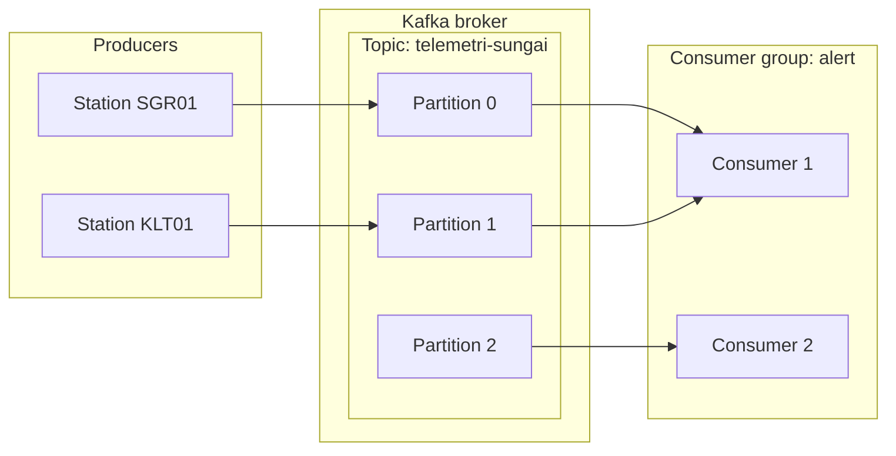

| Word | What it is | In our river system |
|---|---|---|
| **Broker** | A Kafka server. It stores data and serves it. | You run one, called `kafka` |
| **Topic** | A named stream of messages, like a table name for events | `telemetri-sungai` |
| **Partition** | A topic is split into partitions so the work can be shared. Each partition is an ordered log. | `telemetri-sungai` has 3 partitions |
| **Offset** | The position of a message inside a partition: 0, 1, 2, … It never changes. | "Partition 1, offset 57" is one exact reading |
| **Producer** | A program that writes messages to a topic | The station simulator |
| **Consumer** | A program that reads messages from a topic | The flood alert program |
| **Consumer group** | Consumers that share the work of reading a topic. Each partition goes to one member. | Two copies of the alert program in group `alert` |
| **Key** | An optional label on a message. Messages with the same key always go to the same partition. | The station ID, e.g. `KLT01` |
| **Replica** | A copy of a partition on another broker, so a broker can fail without losing data | Production clusters keep 3. Your lab has one broker, so one copy (Topic 9). |

A partition is an append-only log. New messages go on the end and old ones are never edited:

```
Partition 1:  [0] [1] [2] [3] [4] [5] [6] ← new messages are added here
                           ▲
                           group "alert" has read up to here (its committed offset)
```

Rules to remember:

1. **Order is kept inside one partition only**, not across the whole topic.
2. **In one group, each partition is read by one consumer.** More consumers than partitions leaves some idle.
3. **Each group keeps its own place.** A new group can read everything from the start without affecting other groups.

> **Kafka 4:** Older guides start a separate ZooKeeper service. Kafka 4.0 removed ZooKeeper; Kafka now manages itself (KRaft mode). Ignore any tutorial that asks you to install ZooKeeper.

### 2.2 — Play with it in the visualiser

**Open:** [softwaremill.com/kafka-visualisation](https://softwaremill.com/kafka-visualisation/) in your browser. It is a simulation, not real Kafka: a small cluster where you can watch every message move. You try three setups, from the simplest possible Kafka to a cluster that survives a broken server. Each setup comes with a real system that works the same way.

**How to read the picture**

| On screen | What it is |
|---|---|
| `P` and the grey numbered boxes at the top | The **producer** and the messages waiting to be sent. The number is the order they were produced. |
| A group of rows with a blue **power button** | One **broker**. Each circle `1`, `2`, `3` is a **partition** stored on it. |
| A coloured box in a broker row | One message stored in that partition. The newest is on the left. |
| A small letter under a message (`A`, `B`) | How far that consumer group has read: its **committed offset**. |
| `A` (or `B`) and its rows at the bottom | A **consumer group**. Each row is one consumer, showing the messages it has read. |

**Before you start**
1. Click **Hide Descriptions** at the top, so the picture fits on your screen.
2. After every change on the left, click **Apply Setup** (under the consumers), then **Restart** (at the top). Restart empties the picture, so you only see the new setup.

The visualiser always has one producer; you cannot add more. Each consumer has a **Consumer/share group** drop-down, which starts at `A`.

#### Setup 1 — The simplest Kafka: an online shop's receipts

**Real situation:** a small online shop. Every order on the website is an event, and one email service sends the receipt.


- Everything stays in order: receipts go out in the order the orders came in.
- **The limit:** one partition can be read by only one consumer in a group. During a big sale with ten times the orders, the email service falls behind (lag grows), and starting a second copy does not help: it would sit idle.

**Try it in the visualiser:** **Partitions** `1`, **Brokers** `1`, **Replication factor** `1`, one consumer. Click **Apply Setup**, then **Restart**, and watch for about 20 seconds.

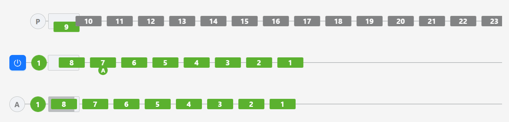

**What you see:** the producer (the shop website) sends 1, 2, 3, … into the only partition, and they are stored in that order. Group `A` (the email service) reads them in the same order. The small `A` under a message moves along as the group commits what it has read.

> **In our river system:** one station into one alert program would work like this, but could never grow.

#### Setup 2 — Share the work, and give a second team its own copy: an e-wallet payment system

**Real situation:** an e-wallet. Thousands of payments arrive every second. The payment team runs three copies of its processor to keep up, and the fraud team checks every payment separately.

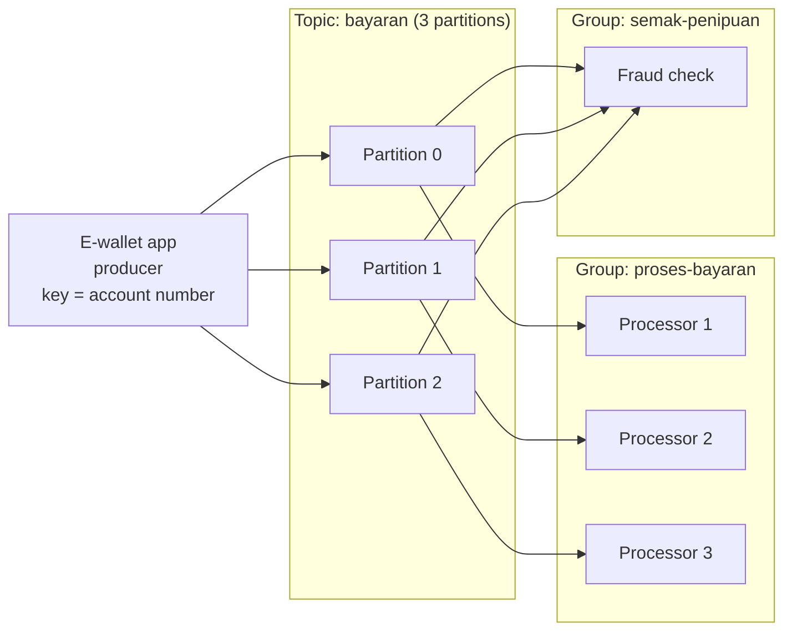

- **The key keeps each account in order.** The app uses the account number as the key, so all payments of one account land in the same partition and are handled by one processor, in order: the top-up is applied before the payment that spends it. Only the order **between** different accounts is lost, and nobody needs it.
- **More processors than partitions is wasted.** To grow beyond three processors, the topic needs more partitions.
- **The fraud check never slows payments down.** It is a different group with its own copy. If it falls behind for a minute, payments still go through.

**Try it in the visualiser:**
1. **Partitions** `3`. Click **Add Consumer** twice: the new consumers join group `A`. **Apply Setup**, **Restart**. Each consumer in `A` now owns one partition: the three processors.
2. Click **Add Consumer** once more (consumer 4, group `A`). **Apply Setup**, **Restart**:

   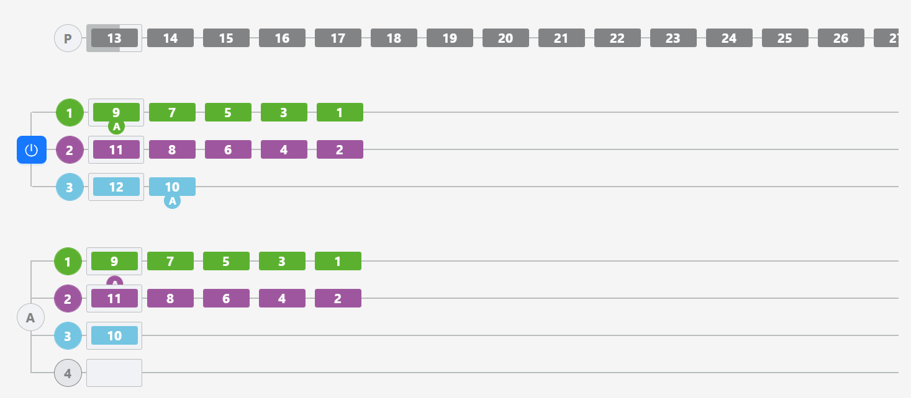

3. In the **Consumer 4** settings, change **Consumer/share group** from `A` to `B`. **Apply Setup**, **Restart**:

   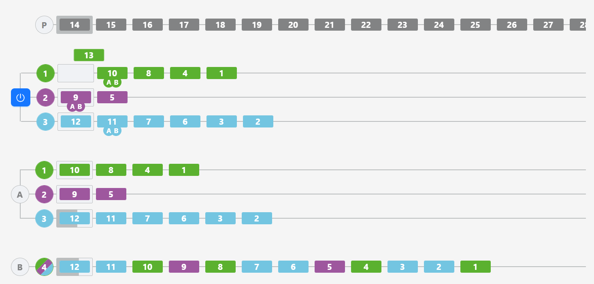

**What you see:**
- Group `A` (the processors) shares the work: one partition each. The fourth consumer in step 2 stays grey and gets nothing, because each partition goes to only one consumer in a group.
- Group `B` (the fraud check) reads **every** message from all three partitions, at its own pace. Under the messages you see `A` and `B` side by side: each group keeps its own bookmark.
- The numbers look out of sequence because the visualiser's producer sends messages **without a key**, so they land in random partitions. With the account number as the key, each account's payments would stay together in one partition.

> **In our river system:** `telemetri-sungai` has 3 partitions and uses the station ID as the key, so each station stays in order. The alert program and the database writer are two different groups. You build this on Day 2 (Topics 15 and 16).

#### Setup 3 — Survive a broken server: an e-hailing app

**Real situation:** an e-hailing app. Every driver's phone sends its location every few seconds, and the matching service uses it to find the nearest driver for each passenger.

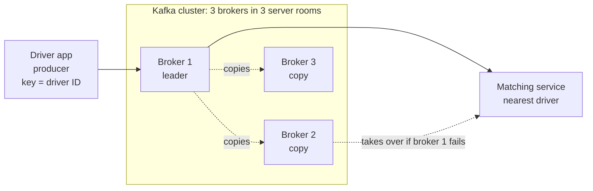

- If a server fails at rush hour, a copy takes over within seconds. Passengers keep getting drivers, and no location is lost.
- Real clusters put each broker in a different server room or data centre, so one power cut or fire cannot take down all copies.
- **The cost:** three copies of every message means three times the disk space and network traffic.

**Try it in the visualiser:**
1. Click **Remove** on **Consumer 4**, to keep the picture small.
2. **Brokers** `3`, **Replication factor** `3`. **Apply Setup**, **Restart**. Scroll down the right side to see all three brokers.

   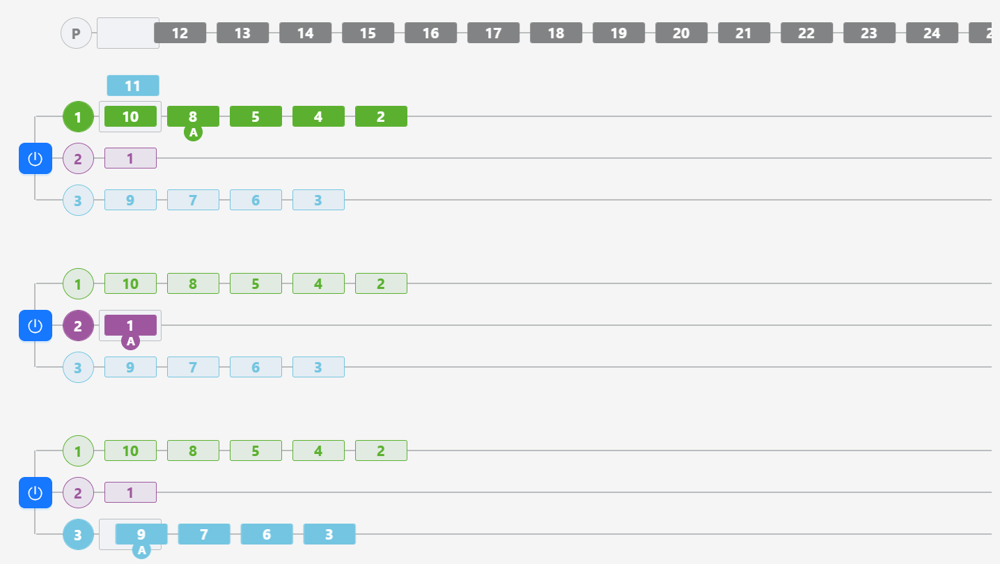

3. Click the **power button** of the first broker. It turns red and fades out. Watch for about 15 seconds.

   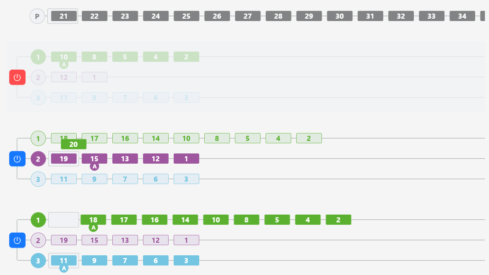

4. Click the power button again to turn the broker back on.

**What you see:**
- Every broker holds all three partitions. In each partition one copy is **solid**: the **leader**, the copy the producer and consumers use. The **faded** copies are **replicas** that only follow the leader.
- When broker 1 goes off (the server failure), the copy of partition 1 on another broker (here, the third) turns solid and takes over. The producer and consumers carry on, and no message is lost.

> **In our river system:** in production, the flood data would run on 3 brokers, so a server failure during a flood loses nothing. Your lab runs 1 broker with 1 copy, so you only see failover here and in Topic 9.

**Try it**
1. A topic has 3 partitions and a group has 5 consumers. How many consumers get no data?
2. KLT01 readings must be processed in time order. What must the producer do?
3. The alert service and the dashboard both need every reading. Same group or different groups?

<details>
<summary>Answers</summary>

1. Two. Each partition goes to one consumer in a group.
2. Use the station ID as the key, so all KLT01 readings land in one partition.
3. Different groups. Each group gets its own full copy of the stream.

</details>

**Checkpoint ✅** You can explain topic, partition, offset, consumer group and key using the river example.

---

## Topic 3 — How Kafka fits an IoT architecture (concept)

**Goal:** see the whole system you will build over two days, and where each piece comes from.

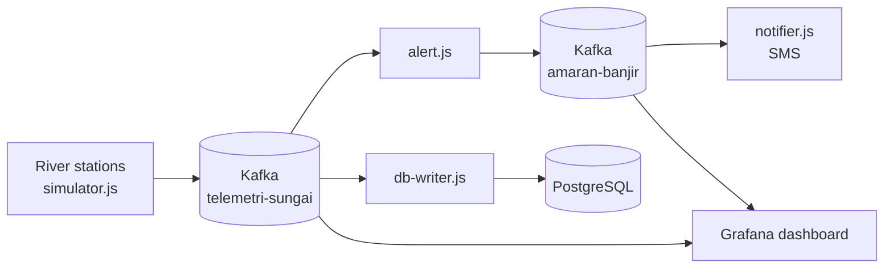

| Box | In the real world | In this course | Built on |
|---|---|---|---|
| River stations | Water level and rain gauges with a data logger | `simulator.js` | Day 1 (run it), Day 2 (read its code) |
| Kafka | A cluster of 3 or more brokers | One broker in Docker | Day 1 |
| Alert service | Watches levels and raises warnings | `alert.js` | Day 2 |
| SMS service | Tells the district office | `notifier.js` prints the SMS | Day 2 |
| Database | Long-term history for reports | `db-writer.js` → PostgreSQL | Day 2 |
| Dashboard | A live chart for the operations room | Grafana, reading Kafka directly | Day 2 |

In the real world the stations do not talk to Kafka directly. A station is a small device on a weak mobile link, and Kafka clients are heavy. A **gateway** collects readings over a light protocol such as MQTT and forwards them to Kafka. Our simulator plays the part of the stations and the gateway together.

The big benefit: **every box on the right reads the same stream independently.** Adding a new service later (say, an email alert) needs no change to the stations or to the other services.

**Checkpoint ✅** You can point to each box in the diagram and say which day builds it.

---

## Topic 4 — Environment setup: Docker and Kafka

**Goal:** understand the Docker pieces, then run Kafka and its tools on your laptop with one command.

### 4.1 — Docker in five words

| Word | What it is | In our setup |
|---|---|---|
| **Image** | A packaged program with everything it needs, downloaded once | `apache/kafka:4.3.2` |
| **Container** | A running copy of an image | `kafka`, `kafka-ui`, `grafana`, `postgres` |
| **Port** | A door from your laptop into a container | `localhost:8085` → the Kafka UI container |
| **Volume** | Storage that outlives the container | `kafka-data` keeps your messages when Kafka restarts |
| **Network** | A private network where containers find each other by name | The Kafka UI reaches Kafka at `kafka:29092` |

**Docker Compose** starts all of these from one file, `docker-compose.yml`, with one command.

### 4.2 — Create your lab folder

1. Create a folder called `kafka-lab`, for example in **Documents**.
2. Copy these from the repository's [`code/`](code/) folder into `kafka-lab`:
   `docker-compose.yml`, the `grafana` folder, `package.json`, `kafka.js`, `stations.js`, `simulator.js`
3. In VS Code: **File → Open Folder…** and open `kafka-lab`.
4. Open a terminal inside VS Code: **Terminal → New Terminal**. Check the folder with `Get-ChildItem -Name`:

   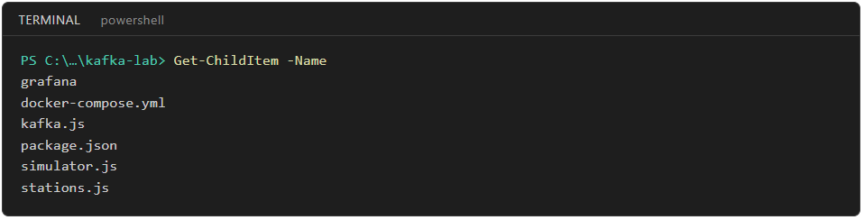

> **Windows:** use the **PowerShell** terminal (the VS Code default). Git Bash rewrites paths such as `/opt/kafka/bin`, and the `docker exec` commands in this course fail there.

### 4.3 — Read the Compose file

Open `docker-compose.yml`. It defines four services:

| Service | What it is | Reach it at |
|---|---|---|
| `kafka` | One Kafka broker. It also manages itself (KRaft). | `localhost:9092` from your laptop |
| `kafka-ui` | The Kafka UI web page | `http://localhost:8085` |
| `grafana` | The dashboard (Day 2) | `http://localhost:3000` |
| `postgres` | The database for saved readings (Day 2) | `localhost:5433` |

The important Kafka settings:

| Setting | What it does |
|---|---|
| `KAFKA_PROCESS_ROLES: broker,controller` | One container stores the data and also manages the cluster |
| `KAFKA_ADVERTISED_LISTENERS` | Two addresses: `localhost:9092` for programs on your laptop, `kafka:29092` for other containers (the Kafka UI, Grafana) |
| `KAFKA_NUM_PARTITIONS: 3` | A new topic gets 3 partitions unless you say otherwise |
| `KAFKA_AUTO_CREATE_TOPICS_ENABLE: "false"` | A typo in a topic name gives an error instead of quietly creating a new topic |
| `KAFKA_LOG_RETENTION_CHECK_INTERVAL_MS: 10000` | Check for expired data every 10 seconds (default 5 minutes), so the retention lab is quick |
| `KAFKA_HEAP_OPTS: -Xmx512M -Xms512M` | Kafka uses at most 512 MB of memory, so it fits on a laptop |
| `restart: unless-stopped` | If Docker Desktop restarts (after sleep, or an update), the containers start again by themselves |

**What can I change later?**

| What | Can it change? | How |
|---|---|---|
| A setting in `docker-compose.yml` | Yes, with a restart | Edit the file, then `docker compose up -d`. Docker rebuilds the container; your topics stay in the `kafka-data` volume. |
| The cluster's identity: `KAFKA_NODE_ID`, `KAFKA_CONTROLLER_QUORUM_VOTERS`, listener names | Not on existing data | They are written into the stored data. Changing them stops Kafka from starting, unless you wipe everything with `docker compose down -v`. |
| A topic setting, e.g. `retention.ms` | Yes, while Kafka runs | Kafka UI or CLI, no restart. You do this in Topic 8. |
| Partitions of a topic | Add only, never remove | `kafka-topics.sh --alter --partitions 6`. The catch: keys may move to a different partition, so a station's order breaks at that moment. Choose enough partitions at the start. |
| Add a broker | Yes, but it is a production job | A second Kafka service with its own node ID and volume. Existing partitions do not move to it by themselves; you move them with `kafka-reassign-partitions.sh`. |
| Remove a broker | Only after moving its data | Move its partitions to other brokers first. In this lab the one broker is also the controller, so removing it means no Kafka. |

> **In this lab** you keep one broker on purpose: four containers in total, and enough for everything except failover (Topic 9).

### 4.4 — Start it

```powershell
docker compose up -d
docker compose ps
```

`docker compose up -d` creates the network, the three volumes and the four containers, then starts them:

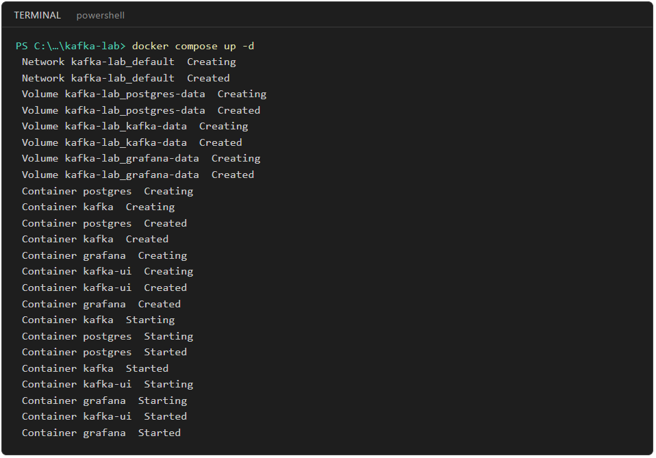

`docker compose ps` should show four containers **Up**: `kafka`, `kafka-ui`, `grafana` and `postgres`, each with its port:

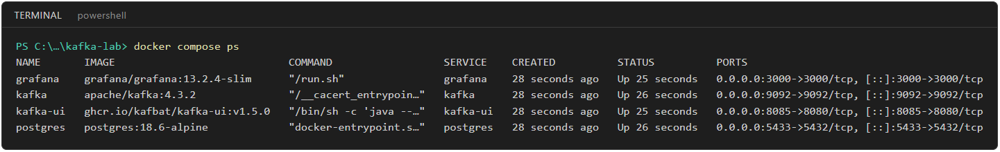

> **Grafana needs internet on its first start.** It downloads its Kafka plugin from grafana.com in the first minute. After that the plugin is kept in the `kafka-lab_grafana-data` volume.

> **Error: `open //./pipe/dockerDesktopLinuxEngine: The system cannot find the file specified`?** Docker Desktop is not running. Start it, wait until the whale icon stops animating, and try again.

> **Error: `Bind for 0.0.0.0:8085 failed: port is already allocated`?** Another program uses that port. In `docker-compose.yml` change the left number, e.g. `"8086:8080"`, run `docker compose up -d` again, and use that port in the browser.

### 4.5 — Look around with Docker

Run each command and connect the output to the table in 4.1:

```powershell
docker images
docker volume ls
docker compose logs --tail 5 kafka
docker stats --no-stream
```

| Command | What you see |
|---|---|
| `docker images` | The downloaded images, including `apache/kafka` |
| `docker volume ls` | `kafka-lab_kafka-data`, where your messages live |
| `docker compose logs` | What a container printed. Add `-f` to keep following it, **Ctrl+C** to stop following. |
| `docker stats` | Memory and CPU per container. Kafka uses roughly 300 MB. Grafana is busy for the first minute while it installs its plugin. |

What you should see, command by command:

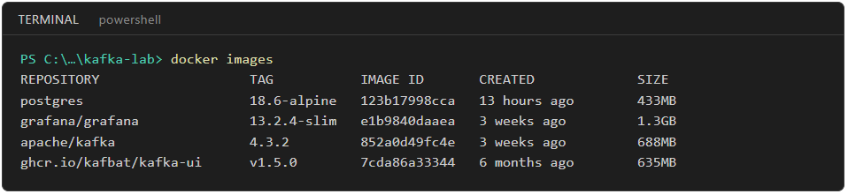

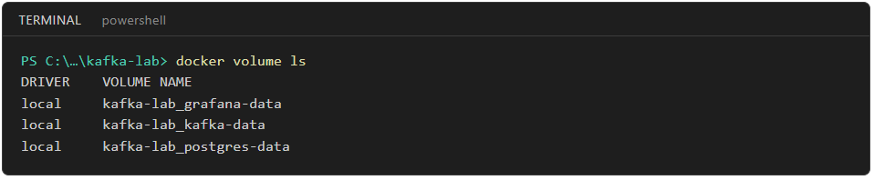

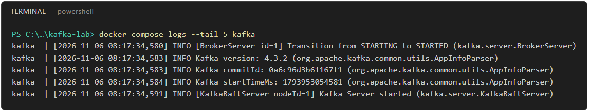

The last line, `Kafka Server started`, means Kafka is ready.

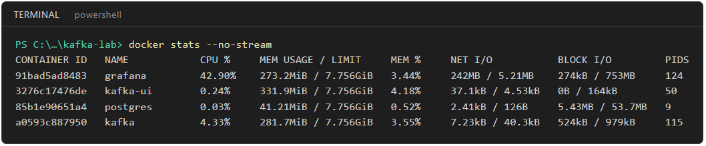

> **Tip: your data survives these commands.** Kafka keeps its data in the `kafka-data` volume, and these commands replace containers, never volumes:
>
> | Command | What happens |
> |---|---|
> | `docker compose up -d` (Kafka already running, file unchanged) | Nothing changes. The containers keep running. |
> | `docker compose up -d` (after editing `docker-compose.yml`) | Docker rebuilds the changed container and attaches the same volume, so the topics and messages are still there. |
> | `docker compose restart`, or `stop` then `start` | The same containers start again with the same data. |
> | `docker compose down`, then `up -d` | The containers are deleted and created again, but the volumes stay, so the data is still there. |
> | Restarting the laptop or Docker Desktop | The containers start again by themselves and the data is still there. |
>
> Only `docker compose down -v` deletes the data: the `-v` removes the volumes.

### 4.6 — Open the Kafka UI

1. Open `http://localhost:8085`. The **Dashboard** shows one cluster, **lab**, online with 1 broker. Click **lab** in the left menu.

   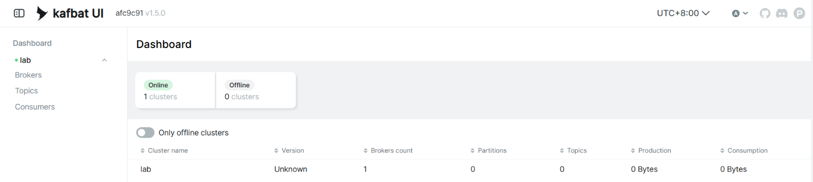

2. Click **Brokers**: one broker, ID 1, and **Controller Type** KRaft.

   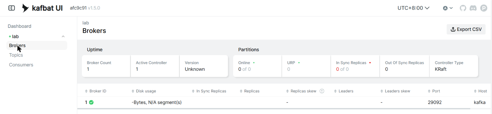

3. Click **Topics**: `No topics found` for now.

   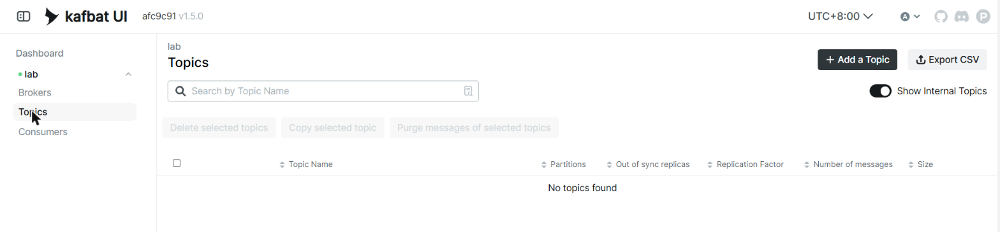

**Try it**
1. **Break it on purpose.** Stop the Kafka UI container: `docker compose stop kafka-ui`. Refresh the browser: the page is gone. Kafka itself is still running: `docker compose ps` shows `kafka` up, and `kafka-ui` is missing from the list. The UI is only a window onto Kafka.

   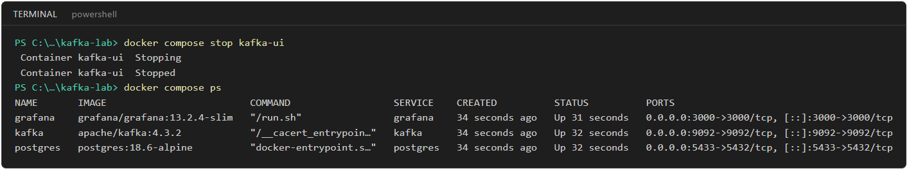

2. **Put everything back:** `docker compose start kafka-ui`. Wait a few seconds and refresh.

   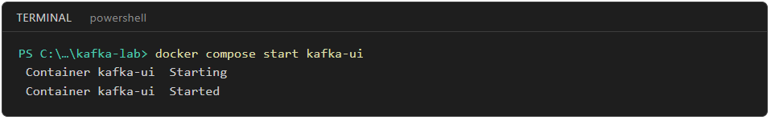

**Checkpoint ✅** `docker compose ps` shows four containers up, and the Kafka UI shows the **lab** cluster with 1 broker.

---

## Topic 5 — Create topics, produce and consume from the CLI and the Kafka UI

**Goal:** move your first messages through Kafka by hand, with both tools.

**Open:** the PowerShell terminal from Topic 4, and the Kafka UI. You open two more terminals in this topic.

**Your terminals today.** Open each one once and keep it open until the end of Day 1. In VS Code, click **+** in the terminal panel for a new terminal.

| Terminal | Opened in | What runs there |
|---|---|---|
| **PowerShell** | Topic 4 | `docker compose …`, `npm install` |
| **Kafka shell 1** | 5.1 | Every Kafka CLI command: `./kafka-….sh` |
| **Kafka shell 2** | 5.4 | A second Kafka CLI command at the same time, e.g. a consumer while shell 1 produces |
| **Simulator** | 6.2 | `node simulator.js`, running all day |

### 5.1 — Open a shell inside Kafka

Kafka ships with CLI tools inside the container. Click **+** for a new terminal and open a shell there. This is **Kafka shell 1**:

```powershell
docker exec -it --workdir /opt/kafka/bin kafka bash
```

| Part | What it does |
|---|---|
| `docker exec` | Run a command inside a container that is already running |
| `-it` | Two flags together. `-i` (interactive) keeps the keyboard connected, so the container receives what you type. `-t` (terminal) gives you a proper terminal with a prompt. Without `-it` the shell starts and closes at once. |
| `--workdir /opt/kafka/bin` | The folder to start in. The Kafka CLI tools live there, so you can type `./kafka-topics.sh` instead of `/opt/kafka/bin/kafka-topics.sh`. |
| `kafka` | The name of the container, from `docker-compose.yml` |
| `bash` | The program to run: a Linux shell |

> **Keep this shell open all day.** Every Kafka command for the rest of Day 1 runs at a Kafka shell prompt, as `./kafka-….sh`. If a shell closes (you typed `exit`, or Kafka restarted), open it again with the same `docker exec` command.

The prompt changes to the container ID and folder, something like `3717641309ac:/opt/kafka/bin$`. Every Kafka command today runs at this prompt.

### 5.2 — Create a practice topic

```bash
./kafka-topics.sh --bootstrap-server localhost:9092 --create --topic ujian --partitions 3
./kafka-topics.sh --bootstrap-server localhost:9092 --list
./kafka-topics.sh --bootstrap-server localhost:9092 --describe --topic ujian
```

The first command creates the topic and prints `Created topic ujian.` Its parts:

| Part | What it does |
|---|---|
| `./kafka-topics.sh` | The Kafka tool for topics: create, list, describe, change and delete. `./` means "in this folder" (`/opt/kafka/bin`, from `--workdir`). |
| `--bootstrap-server localhost:9092` | Which Kafka to talk to. Inside the container, `localhost` is the container itself, so this is your broker. Every Kafka tool needs it. |
| `--create` | What to do: make a new topic |
| `--topic ujian` | The topic's name (*ujian* = test). Names are case-sensitive: `Ujian` would be a different topic. |
| `--partitions 3` | Split the topic into 3 partitions. Leave it out and you get the broker default, `KAFKA_NUM_PARTITIONS` (also 3 in this lab). |

There is no `--replication-factor`, so the topic gets the broker default: 1, because the lab has one broker.

The other two commands use the same tool and server, with a different action:
- `--list` prints every topic name.
- `--describe --topic ujian` shows how the topic is laid out:

```
Topic: ujian	TopicId: …	PartitionCount: 3	ReplicationFactor: 1	Configs: min.insync.replicas=1
	Topic: ujian	Partition: 0	Leader: 1	Replicas: 1	Isr: 1	Elr: 	LastKnownElr: 
	Topic: ujian	Partition: 1	Leader: 1	Replicas: 1	Isr: 1	Elr: 	LastKnownElr: 
	Topic: ujian	Partition: 2	Leader: 1	Replicas: 1	Isr: 1	Elr: 	LastKnownElr: 
```

| Field | Meaning |
|---|---|
| `PartitionCount: 3` | The topic is split into 3 partitions |
| `ReplicationFactor: 1` | Each partition has 1 copy, because there is only one broker (Topic 9) |
| `Leader: 1` | Which broker leads this partition: broker `1` (`KAFKA_NODE_ID` in the Compose file) takes all its reads and writes. With one broker, it leads every partition. |
| `Replicas: 1` | Every broker that holds a copy. The first one listed is the preferred leader. |
| `Isr: 1` | In-sync replicas: the copies that are fully up to date. Only these can become leader. |
| `Elr`, `LastKnownElr` | Kafka 4's backup list of copies that can still safely become leader. Empty here: there is nothing to fall back on. |

With 3 brokers and replication factor 3 (not this lab), the leaders are spread out:

```
Partition: 0  Leader: 2  Replicas: 2,3,1  Isr: 2,3,1
Partition: 1  Leader: 3  Replicas: 3,1,2  Isr: 3,1,2
Partition: 2  Leader: 1  Replicas: 1,2,3  Isr: 1,2,3
```

If broker 2 stops, partition 0 shows `Leader: 3  Isr: 3,1`: another copy took over. That is the failover you saw in the visualiser.

### 5.3 — Produce messages

```bash
./kafka-console-producer.sh --bootstrap-server localhost:9092 --topic ujian
```

You get a `>` prompt. Type a few lines, pressing **Enter** after each:

```
>Sungai Kelantan naik
>Hujan lebat di Kuala Krai
```

Leave this running.

### 5.4 — Consume them in the second terminal

Click **+** for a new terminal and open a second shell there. This is **Kafka shell 2**:

```powershell
docker exec -it --workdir /opt/kafka/bin kafka bash
```

Start a consumer in it:

```bash
./kafka-console-consumer.sh --bootstrap-server localhost:9092 --topic ujian --from-beginning
```

Your two lines appear. Now type a new line in **Kafka shell 1**. It shows up in Kafka shell 2 within a second. That is streaming.

> **Note:** The consumer first prints `The consumer rebalance protocol (KIP-848) is production-ready!…`. That is information about a newer Kafka feature. Ignore it.

Press **Ctrl+C** in both shells. Keep both shells open.

### 5.5 — Messages with a key

In **Kafka shell 1**, start a producer that reads `key:value`:

```bash
./kafka-console-producer.sh --bootstrap-server localhost:9092 --topic ujian --reader-property parse.key=true --reader-property key.separator=:
```

```
>KLT01:{"paras_air":18.2}
>PHG01:{"paras_air":30.1}
>KLT01:{"paras_air":18.4}
```

In **Kafka shell 2**, show the key, partition and offset of each message:

```bash
./kafka-console-consumer.sh --bootstrap-server localhost:9092 --topic ujian --from-beginning --formatter-property print.key=true --formatter-property print.partition=true --formatter-property print.offset=true
```

Look at the `Partition:` column. Both KLT01 messages are in the **same** partition. The two unkeyed lines from 5.3 may be anywhere. Stop both with **Ctrl+C**. Keep both shells open.

> **Older guides** use `--property` for these settings. In Kafka 4.x it is deprecated: use `--reader-property` (producer) and `--formatter-property` (consumer).

### 5.6 — Create the course topics in the Kafka UI

These are the two topics the rest of the course uses. Now you create them empty; the programs that fill and read them come later.

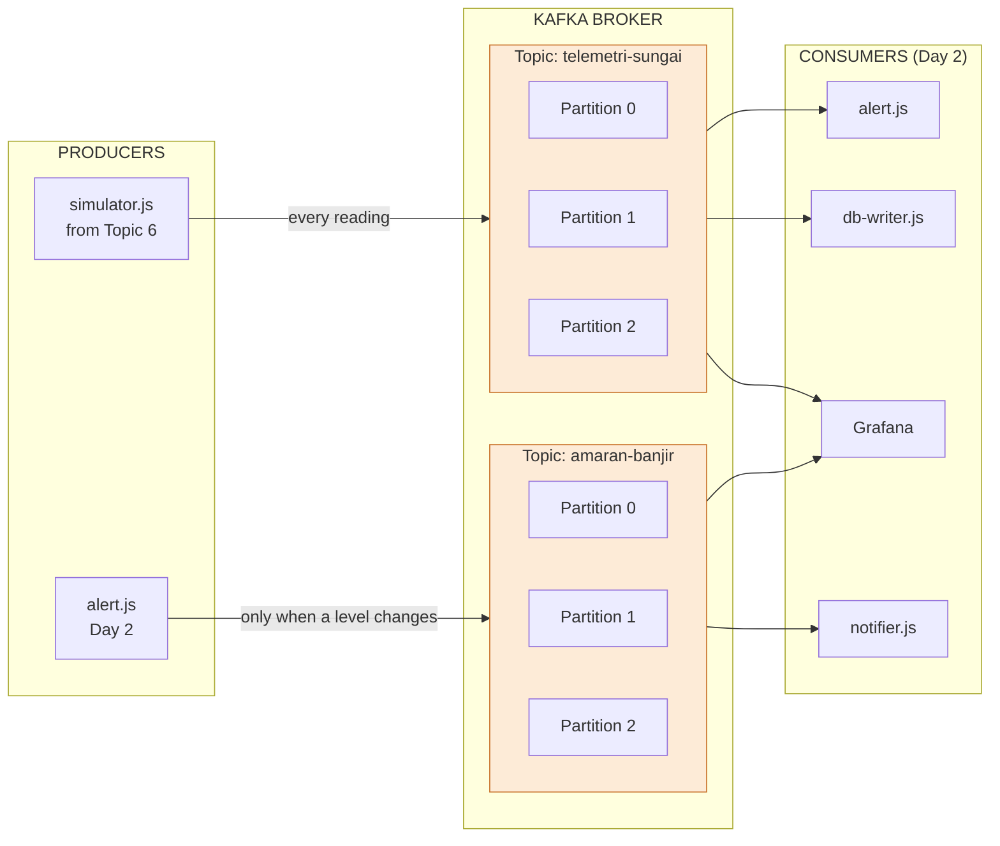

| Topic | What goes in it | Who writes | Who reads |
|---|---|---|---|
| `telemetri-sungai` | Every river reading, one per station per second | `simulator.js` (from Topic 6) | `alert.js`, `db-writer.js`, Grafana, and you with the CLI |
| `amaran-banjir` | A flood alert, only when a station's level changes stage | `alert.js` (Day 2) | `notifier.js`, Grafana |

The two orange topic boxes, each with its 3 partitions, are what you create in this step. `alert.js` appears twice because it is one program on both sides: it consumes the readings and produces the alerts. The `ujian` topic from 5.2 was only practice.

**First, make sure the containers are running.** The Kafka UI needs both `kafka` and `kafka-ui`. You started them in Topic 4.4, but they stop if Docker Desktop was closed or the laptop restarted. In the **PowerShell** terminal (not a Kafka shell), in your `kafka-lab` folder:

```powershell
docker compose up -d
docker compose ps
```

`docker compose up -d` starts anything that is stopped and leaves running containers alone, so it is always safe to run. `docker compose ps` must show `kafka` and `kafka-ui` as **Up**. Wait about 20 seconds after a fresh start, then open `http://localhost:8085`.

1. In the Kafka UI click **Topics → Add a Topic**.
2. **Topic Name \***: `telemetri-sungai`
3. **Number of Partitions \***: `3`
4. **Replication Factor**: `1`

   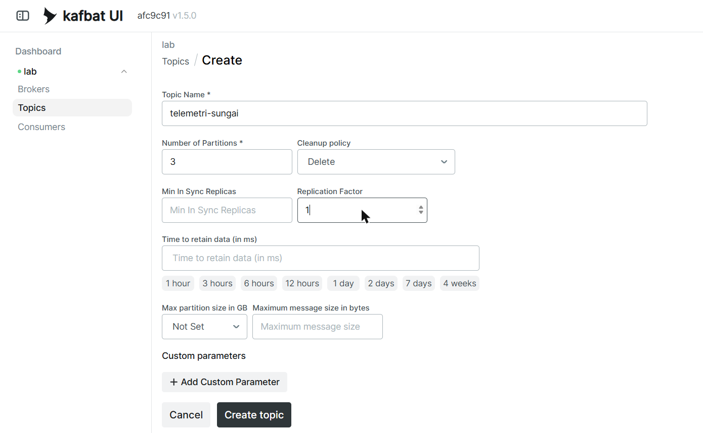

5. Click **Create topic**.
6. Do the same again for a second topic: **Topic Name** `amaran-banjir`, **3** partitions, replication factor **1**. Your flood alerts go here on Day 2.

   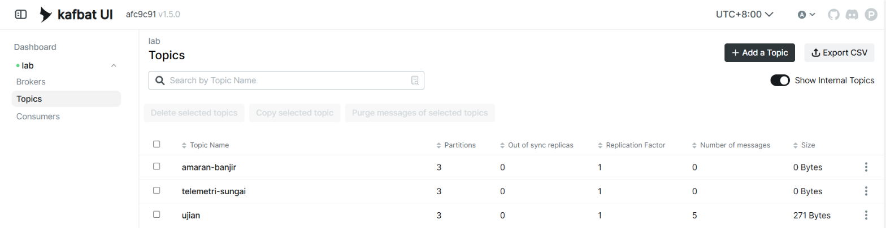

### 5.7 — Produce a message from the Kafka UI

1. Open **Topics → telemetri-sungai** and click **Produce Message**.
2. **Partition:** `Partition #1`. The Kafka UI does not work out the partition from the key: you choose it. Partition 1 is where every KLT01 reading goes (you see why in Topic 6).
3. **Key:** `KLT01`
4. **Value:**
   ```json
   {"stesen":"KLT01","masa":"2026-11-10T01:00:00.000Z","paras_air":18.2,"hujan":0.5}
   ```

   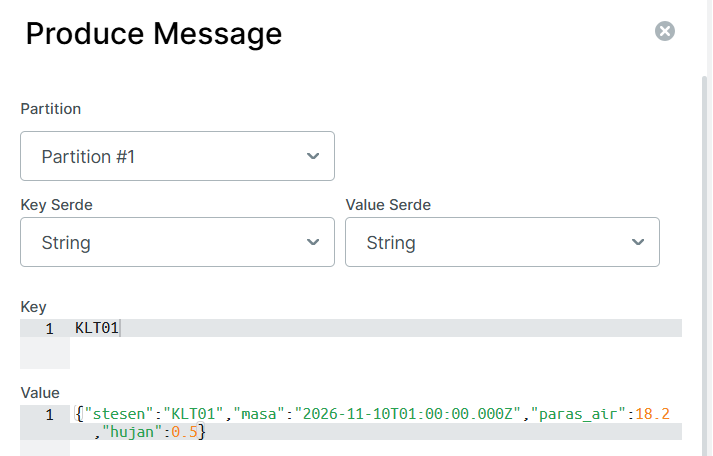

5. Click **Produce Message** at the bottom of the panel. A green **Message successfully sent** appears.
6. Open the **Messages** tab. Your message is there, with its offset, partition, timestamp, key and value.

   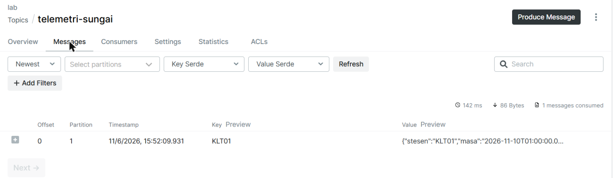

7. **Send a second message** the same way: **Produce Message**, `Partition #1`, **Key** `PHG01`, **Value**:
   ```json
   {"stesen":"PHG01","masa":"2026-11-10T01:00:00.000Z","paras_air":30.4,"hujan":1.2}
   ```
   Click **Refresh** in the **Messages** tab. Two messages are waiting: KLT01 at offset 0 and PHG01 at offset 1.

   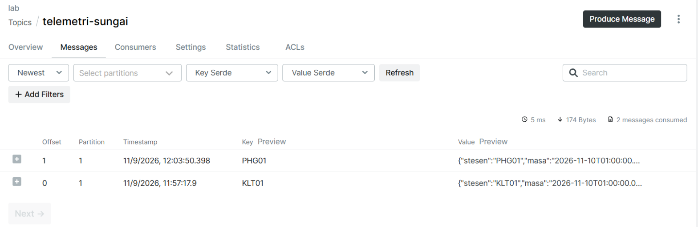

8. **Check that nobody has read them.** Open the **Consumers** tab of `telemetri-sungai`: **No active consumer groups**. No program has read this topic yet.

   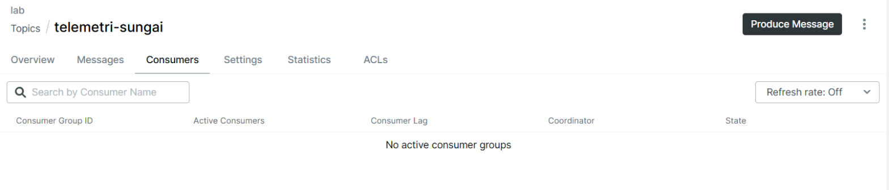

   > **"But the Messages tab says `2 messages consumed`?"** That only counts what the page loaded for you to look at. Looking at messages in the Kafka UI is not reading them as a consumer group, and the Kafka UI cannot read as a group. A consumer program does that: here, the CLI consumer.

9. **Read them with a consumer.** In **Kafka shell 1**, read the topic as a consumer group called `pembaca` (*reader*):
   ```bash
   ./kafka-console-consumer.sh --bootstrap-server localhost:9092 --topic telemetri-sungai --group pembaca --from-beginning --formatter-property print.partition=true --formatter-property print.offset=true --formatter-property print.key=true --max-messages 2
   ```
   Both messages print, in the order they were sent, and the consumer stops by itself:
   ```
   Partition:1	Offset:0	KLT01	{"stesen":"KLT01","masa":"2026-11-10T01:00:00.000Z","paras_air":18.2,"hujan":0.5}
   Partition:1	Offset:1	PHG01	{"stesen":"PHG01","masa":"2026-11-10T01:00:00.000Z","paras_air":30.4,"hujan":1.2}
   Processed a total of 2 messages
   ```
   `--max-messages 2` tells the consumer to stop after 2 messages. Before it stops, it saves the group's bookmark.

10. **See it in the Kafka UI.** Open the **Consumers** tab of `telemetri-sungai` again. Group `pembaca` is there with **Consumer Lag** `0`: it has read everything.

    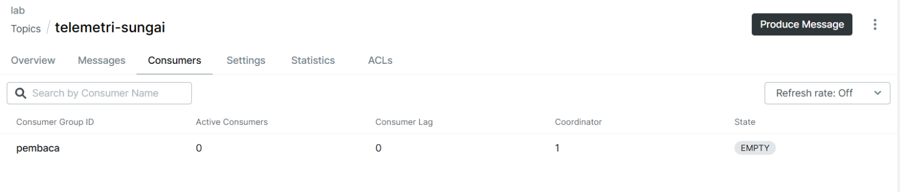

    Click `pembaca`, then **+** next to `telemetri-sungai`. In partition 1, **Current Offset** `2` equals **End offset** `2`: the group's bookmark is after the last message.

    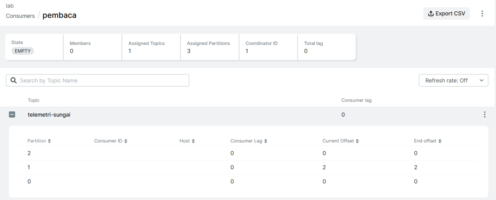

11. **Run the command in step 9 again.** This time nothing prints: the consumer waits for new messages, because group `pembaca` remembers where it stopped and does not read the same messages twice. (`--from-beginning` only applies to a group that has never read the topic.) Press **Ctrl+C** to stop it.
12. Open the **Messages** tab and click **Refresh**: both messages are **still there**. Reading did not delete them.

> **This is the big difference from a traditional queue (Topic 1.4).** A queue usually deletes a message once someone reads it. Kafka keeps it until retention expires (7 days by default), and each consumer group keeps its own bookmark. A new group would read both messages again from the start. You try that in Topic 7.

**Checkpoint ✅** The Kafka UI lists `telemetri-sungai` and `amaran-banjir` with 3 partitions each, and the **Messages** tab of `telemetri-sungai` shows your KLT01 and PHG01 messages, and group `pembaca` has read both (lag 0) without removing them.

---

## Topic 6 — The station simulator: live data all the time

**Goal:** get real river data flowing into Kafka, and watch it with both tools.

### 6.1 — Install KafkaJS

The simulator is a small Node.js program that uses **KafkaJS**, a Kafka client library. `package.json` lists it, together with `pg`, the PostgreSQL client you use on Day 2. In a terminal in `kafka-lab` (not inside the container):

```powershell
npm install
```

> **About KafkaJS:** KafkaJS is the most widely used pure-JavaScript Kafka client and installs anywhere with no build tools. Its last release (2.2.4) was in February 2023 and the project is no longer actively developed. It works with Kafka 4.3 (tested for this course in November 2026). For a new production system, also evaluate **`@confluentinc/kafka-javascript`**, which Confluent maintains and which offers a KafkaJS-style API. What you learn in this course (topics, keys, groups, offsets) is the same in every client.

### 6.2 — Start the simulator

Click **+** for a new terminal, the **Simulator** terminal, because it keeps running. It opens in your `kafka-lab` folder:

```powershell
node simulator.js
```

```
Simulator started: 6 stations, every second. Ctrl+C to stop.
[3:15:21 pm] sent 6 readings
[3:15:22 pm] sent 6 readings
```

Leave it running all day. It sends one JSON reading per station every second, with the station ID as the key:

```json
{ "stesen": "KLT01", "masa": "2026-11-10T08:27:30.861Z", "paras_air": 17.98, "hujan": 1.5 }
```

You read its code tomorrow. For today it is a tool, like the Kafka UI.

> **Seeing `TimeoutNegativeWarning: … is a negative number`?** This is a harmless warning from KafkaJS on newer Node.js versions. Everything works normally. To hide it, run `node --no-warnings simulator.js`.

### 6.3 — Watch it in the Kafka UI

1. Open **Topics → telemetri-sungai → Messages**.
2. Change the mode drop-down from **Newest** to **Live**. New readings scroll in every second.
3. Type `KLT01` in **Search** and press **Enter** to see one station only. Every KLT01 reading is in partition 1.

   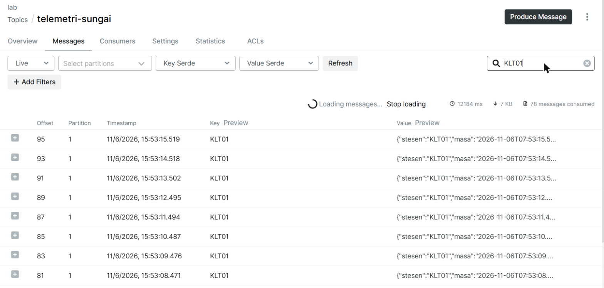

4. Open the **Overview** tab: the message count grows in every partition.

   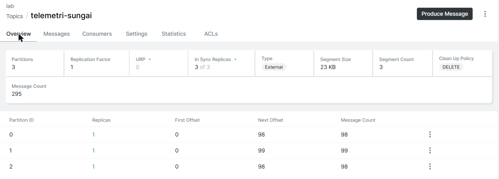

### 6.4 — Watch it with the CLI

In **Kafka shell 1**, follow the stream with the key and partition of each message:

```bash
./kafka-console-consumer.sh --bootstrap-server localhost:9092 --topic telemetri-sungai --formatter-property print.key=true --formatter-property print.partition=true
```

```
Partition:1	KLT01	{"stesen":"KLT01","masa":"2026-11-10T08:27:30.861Z","paras_air":17.98,"hujan":1.5}
Partition:0	TRG01	{"stesen":"TRG01","masa":"2026-11-10T08:27:30.862Z","paras_air":10.14,"hujan":0.3}
Partition:2	KDH01	{"stesen":"KDH01","masa":"2026-11-10T08:27:30.861Z","paras_air":6.12,"hujan":2.9}
```

Watch for a minute. Each station always appears with the **same partition number**: that is the key at work. Press **Ctrl+C** to stop.

**Try it**
1. Stop the simulator (**Ctrl+C** in its terminal) and start it with heavy rain at Kuala Krai: `node simulator.js --flood KLT01`. In the Kafka UI (**Live**, **Search** `KLT01`), watch `paras_air` climb by 0.05 m every second.
2. **Put everything back:** stop it and start plain `node simulator.js` again.

**Checkpoint ✅** The simulator is running, and you can see its readings live in both the Kafka UI and the CLI.

---

## Topic 7 — Consumer groups, lag and replay by hand

**Goal:** watch a group share partitions, fall behind, catch up and replay the past, with no code.

**Open:** Kafka shells 1 and 2, and the Kafka UI. The simulator must be running.

### 7.1 — Two consumers, one group

In **Kafka shells 1 and 2**, start the same consumer in group `cli-group`:

```bash
./kafka-console-consumer.sh --bootstrap-server localhost:9092 --topic telemetri-sungai --group cli-group --formatter-property print.partition=true --formatter-property print.key=true
```

Compare the two shells. Each shows only **some** partitions: Kafka gave partitions to one member and the rest to the other. A station always appears in the same shell.

In the Kafka UI click **Consumers → cli-group**: **Members** = 2. Click **+** next to `telemetri-sungai` to see which consumer owns which partition.

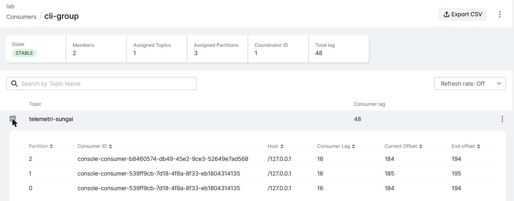

> **How Kafka shares the partitions:** one broker is the group's **coordinator**, and the first consumer to join becomes the group **leader**. The leader uses the **range** rule: it sorts the partitions (0, 1, 2) and the consumer IDs, then cuts the partitions into blocks. With 3 partitions and 2 consumers, the first ID gets **0 and 1** and the second gets **2**. The IDs are random (`console-consumer-5a23…`), so you cannot predict which shell gets two. The sharing is redone (a **rebalance**) when a member joins, leaves (Ctrl+C: at once), crashes (after about 45 seconds) or the topic gets more partitions. Key → partition never changes; partition → consumer can change at every rebalance.
>
> **Day 2:** KafkaJS uses **round robin** instead (p0 and p2 to one consumer, p1 to the other), so the split looks different.

### 7.2 — A member leaves

Press **Ctrl+C** in Kafka shell 2. Within a few seconds Kafka shell 1 shows **every** partition. This is a **rebalance**: the group re-shared the partitions among the members left.

### 7.3 — Lag: falling behind

1. Press **Ctrl+C** in Kafka shell 1 as well. The group now has no members, but the simulator keeps writing.
2. Wait a minute, then in Kafka shell 2 describe the group:
   ```bash
   ./kafka-consumer-groups.sh --bootstrap-server localhost:9092 --describe --group cli-group
   ```
   ```
   Consumer group 'cli-group' has no active members.

   GROUP      TOPIC            PARTITION  CURRENT-OFFSET  LOG-END-OFFSET  LAG
   cli-group  telemetri-sungai 0          512             632             120
   cli-group  telemetri-sungai 1          515             635             120
   cli-group  telemetri-sungai 2          510             630             120
   ```

| Column | Meaning |
|---|---|
| `CURRENT-OFFSET` | The group's committed offset: where it continues after a restart |
| `LOG-END-OFFSET` | The offset the next new message will get |
| `LAG` | `LOG-END-OFFSET − CURRENT-OFFSET`: messages waiting to be read |

3. Look at the same group in the Kafka UI: **Consumers → cli-group** shows **State** `EMPTY`, **Members** 0, and the lag per partition.

   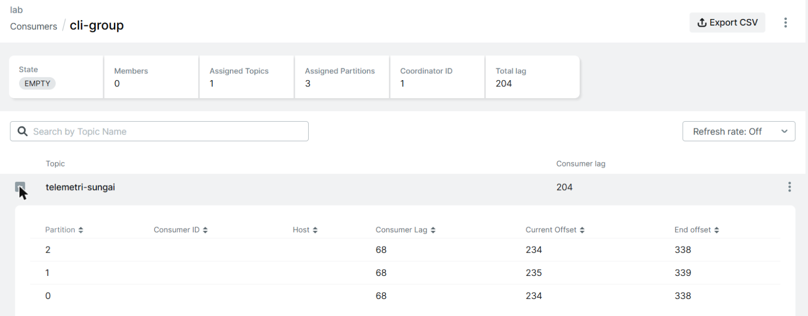

4. Start the consumer again in Kafka shell 1. It prints the waiting messages in a burst, then slows to one per station per second. Describe the group again: `LAG` is back near 0.

Lag is **the** number to watch in production. Growing lag means the consumers cannot keep up, or are down.

### 7.4 — Replay the past

Kafka keeps the messages, so a group can go back and read them again. Stop the consumer in Kafka shell 1 (a group must have no running members to be reset). Then, in Kafka shell 2, move `cli-group` back 5 minutes:

```bash
./kafka-consumer-groups.sh --bootstrap-server localhost:9092 --group cli-group --topic telemetri-sungai --reset-offsets --by-duration PT5M --execute
```

`PT5M` means "5 minutes ago" (`PT1H` = 1 hour). Start the consumer in Kafka shell 1 again: it replays the last 5 minutes, then carries on live.

Other ways to choose where to restart:

| Option | Moves the group to |
|---|---|
| `--to-earliest` | The oldest message still kept |
| `--to-latest` | The end (skip everything waiting) |
| `--to-datetime 2026-11-10T09:30:00.000+08:00` | A clock time, Malaysia time |
| `--to-offset 100` | An exact offset |
| `--dry-run` instead of `--execute` | Show the new offsets without changing anything |

**Try it**
1. Do a reset in the Kafka UI instead. Stop the consumer, open **Consumers → cli-group**, click the **⋮** menu at the top right, then **Reset offset**.

   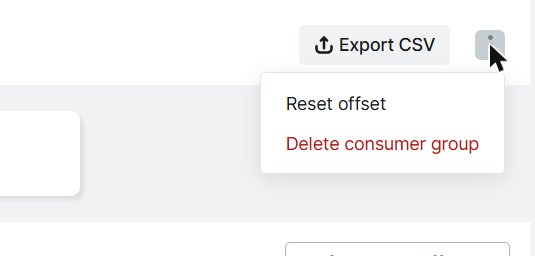

   Choose **Topic** `telemetri-sungai`, **Reset Type** `EARLIEST`, and in **Partitions** tick **Select All** (the button stays grey until you pick partitions). Click **Reset Offsets**. Start the consumer: it reads from the very first message.

   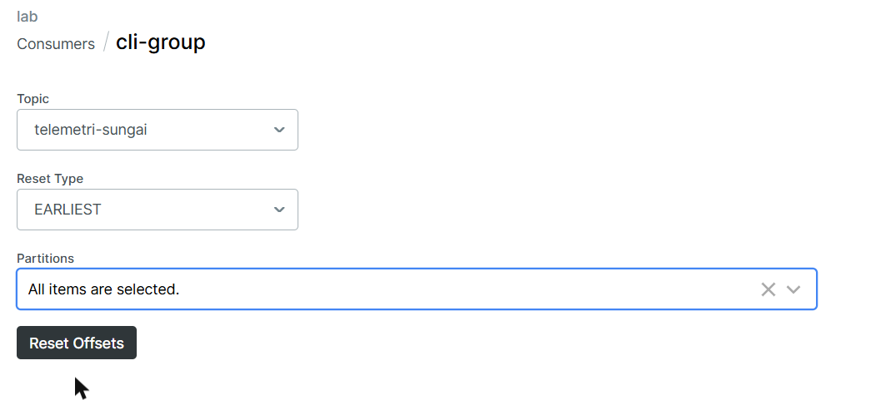
2. **Mark everything as read.** The opposite of a replay: skip what is waiting. Stop the consumer and wait a minute, so **Consumers → cli-group** shows lag on every partition. Open **⋮ → Reset offset** again and choose **Reset Type** `LATEST`, **Select All** partitions, then **Reset Offsets**. The lag drops to **0**. Start the consumer: it prints only new readings, nothing from the backlog. The CLI does the same with `--to-latest` in place of `--by-duration PT5M`.

   > **Read, not deleted:** the skipped messages are still in Kafka, and other groups still see them as unread. Use this when a backlog is no longer useful (a live dashboard after a long outage). The skipped messages are never handled by this group, unless you reset it back by time while they are still kept.
3. **Break it on purpose.** Start the consumer, then run the `--reset-offsets` command from 7.4 in Kafka shell 2. The CLI refuses:
   ```
   Error: Assignments can only be reset if the group 'cli-group' is inactive, but the current state is Stable.
   ```
   Resetting under a running consumer would pull the data out from under it.
4. **Put everything back:** press **Ctrl+C** in both Kafka shells. Leave the simulator running.

**Checkpoint ✅** You have seen a group rebalance, lag grow and shrink, a group replay the last 5 minutes, and a group skip its backlog.

---

## Topic 8 — Retention and compaction

**Goal:** control how long Kafka keeps data, and keep only the latest value per key.

### 8.1 — Retention: old data expires

By default Kafka keeps messages for 7 days, then deletes them, whether anyone read them or not. Kafka stores each partition as files on disk, called **segments**, and deletes old data one whole segment at a time.

In **Kafka shell 1**, make a topic that keeps data for only **1 minute**, with a new segment every 10 seconds:

```bash
./kafka-topics.sh --bootstrap-server localhost:9092 --create --topic ujian-retensi --partitions 1 --config retention.ms=60000 --config segment.ms=10000
for i in $(seq 1 12); do echo "isyarat $i" | ./kafka-console-producer.sh --bootstrap-server localhost:9092 --topic ujian-retensi; sleep 10; done
```

The loop sends one message every 10 seconds for 2 minutes. While it runs, check the topic from **Kafka shell 2** every 30 seconds:

```bash
./kafka-get-offsets.sh --bootstrap-server localhost:9092 --topic ujian-retensi --time -2
```

```
ujian-retensi:0:0
...
ujian-retensi:0:4
```

The last number is the **earliest offset still kept**. After about a minute it starts to climb from `0`: the oldest messages are gone. Read the topic from the beginning and see that the first `isyarat` lines have disappeared:

```bash
./kafka-console-consumer.sh --bootstrap-server localhost:9092 --topic ujian-retensi --from-beginning --timeout-ms 5000
```

### 8.2 — Compaction: keep only the latest value per key

Some data is "the current state of something", not a history: each station's latest status, for example. A **compacted** topic keeps only the newest message for each key and throws older ones away.

In **Kafka shell 1**:

```bash
./kafka-topics.sh --bootstrap-server localhost:9092 --create --topic status-stesen --partitions 1 --config cleanup.policy=compact --config segment.ms=10000 --config min.cleanable.dirty.ratio=0.01
printf 'KLT01:NORMAL\nPHG01:NORMAL\nKLT01:WASPADA\nKLT01:AMARAN\nKLT01:BAHAYA\nPHG01:WASPADA\n' | ./kafka-console-producer.sh --bootstrap-server localhost:9092 --topic status-stesen --reader-property parse.key=true --reader-property key.separator=:
for i in 1 2 3; do sleep 10; echo "PHG01:WASPADA" | ./kafka-console-producer.sh --bootstrap-server localhost:9092 --topic status-stesen --reader-property parse.key=true --reader-property key.separator=:; done
./kafka-console-consumer.sh --bootstrap-server localhost:9092 --topic status-stesen --from-beginning --timeout-ms 5000 --formatter-property print.key=true --formatter-property print.offset=true
```

KLT01 was sent four times (NORMAL, WASPADA, AMARAN, BAHAYA). After compaction only one is left:

```
Offset:4	KLT01	BAHAYA
Offset:7	PHG01	WASPADA
Offset:8	PHG01	WASPADA
```

The older KLT01 and PHG01 messages are gone, but offset 4 is still offset 4: compaction removes messages, it never renumbers them. You may see one or two more `PHG01:WASPADA` lines than this: the newest segment is never compacted until it closes.

> **`ERROR Error processing message, terminating consumer process … TimeoutException`** at the end is normal: `--timeout-ms 5000` tells the consumer to quit after 5 seconds with no new messages, and it reports that as an error.

| | `cleanup.policy=delete` (default) | `cleanup.policy=compact` |
|---|---|---|
| Keeps | Everything newer than `retention.ms` | The newest message for every key, forever |
| Good for | Readings, events, logs | Latest status, settings, a lookup table |
| Our use | `telemetri-sungai` | `status-stesen` |

**Try it**
1. In the Kafka UI open **Topics → ujian-retensi → Settings**. Find `retention.ms` = `60000` (the UI adds "1 minute") and `segment.ms` = `10000`, the values you set.

   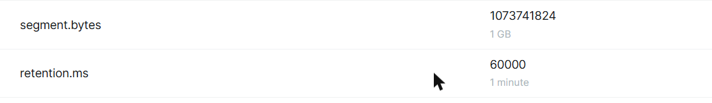

2. Open **Topics → telemetri-sungai → Settings** and compare: `retention.ms` = `604800000` (7 days).

**Checkpoint ✅** You have watched messages expire after one minute, and seen compaction keep only BAHAYA for KLT01.

---

## Topic 9 — Replication and failover (concept)

**Goal:** know how production Kafka survives a broken server, even though your lab has only one.

Your lab runs **one** broker, so every partition has **one** copy. If that broker stops, the topic is unavailable until it comes back. Try it: `docker compose stop kafka`, and the simulator prints `Send failed` every second. `docker compose start kafka`, and it carries on. Nothing was lost, because the data was on disk in the volume. But nothing could be written while it was down.

Production clusters run **3 or more brokers** and keep **3 copies** of every partition:

| Word | What it means |
|---|---|
| **Replication factor 3** | Each partition is stored on 3 different brokers |
| **Leader** | The one copy that takes reads and writes. The others (followers) copy it. |
| **ISR (in-sync replicas)** | The copies that are fully up to date with the leader |
| **`min.insync.replicas=2`** | A write counts as safe only when at least 2 copies have it |
| **Failover** | When the leader's broker stops, an in-sync follower becomes the new leader within seconds. Producers and consumers find it by themselves. |

With 3 copies and `min.insync.replicas=2`:

| Brokers down | What happens |
|---|---|
| 0 | Normal |
| 1 | A new leader takes over. Nothing is lost, nothing stops. |
| 2 | Kafka **refuses new writes** rather than accept data that only one broker holds |

Remember the visualiser in Topic 2: you turned off a broker and another one took over. That is failover.

**Try it**
1. In the visualiser, set **Brokers** `3`, **Replication factor** `3`, and turn off two brokers. What happens to the producer? (The visualiser keeps accepting writes, because it uses the old setting `min.insync.replicas=1`. A real cluster set up as above would refuse them.)

**Checkpoint ✅** You can explain what replication factor, leader and ISR mean, and what happens when one or two brokers fail.

---

## Topic 10 — Headers, timestamps and size limits

**Goal:** see everything a message carries besides its key and value, and the size limit that keeps Kafka fast.

**Open:** Kafka shell 1 and the Kafka UI. The simulator must be running.

### 10.1 — Headers: labels on the outside of a message

A **header** is a small name and value attached to a message, like the label on a parcel. A program can read it without opening the value. Real systems use headers for which system sent the message, the format version, or a trace ID that follows one request through many services.

1. In the Kafka UI open **Topics → telemetri-sungai** and click **Produce Message**.
2. **Partition** `Partition #1`, **Key** `KLT01`, **Value**:
   ```json
   {"stesen":"KLT01","masa":"2026-11-10T01:00:00.000Z","paras_air":18.2,"hujan":0.5}
   ```
3. **Headers:** replace the `{}` that is already there with:
   ```json
   {"sumber":"kafka-ui","versi":"1"}
   ```
   The editor adds closing brackets by itself. Check there is exactly one `}` at the end.

   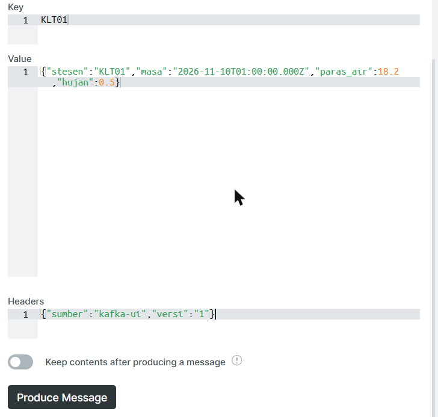

4. Click **Produce Message**.
5. Find it from the CLI. In **Kafka shell 1**, read partition 1 from the start, with headers, and keep only the lines that have a `sumber` header:
   ```bash
   ./kafka-console-consumer.sh --bootstrap-server localhost:9092 --topic telemetri-sungai --partition 1 --offset earliest --formatter-property print.timestamp=true --formatter-property print.offset=true --formatter-property print.headers=true --formatter-property print.key=true --timeout-ms 5000 2>/dev/null | grep sumber
   ```
   ```
   CreateTime:1794199200979	Offset:1318	sumber:kafka-ui,versi:1	KLT01	{"stesen":"KLT01","masa":"2026-11-10T01:00:00.000Z","paras_air":18.2,"hujan":0.5}
   ```
   Your offset and time are different. Every simulator message has `NO_HEADERS` instead, so `grep` hides them. (`2>/dev/null` hides the normal `TimeoutException` at the end.)
6. Look at it in the Kafka UI. In **Messages**, change **Newest** to **From offset**, type your offset, choose **Partition #1** in **Select partitions**, and press **Enter**. Click **+** on the first row, then the **Headers** tab.

   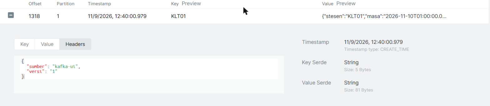

### 10.2 — Two times in every message

Look at the same expanded row. The message has **two** times:

| Time | Where | Who sets it | What it means |
|---|---|---|---|
| `masa` | Inside the value | The station: it is your data | When the reading was measured: 10 Nov, 01:00 |
| **Timestamp** | Outside, on every Kafka message | The producer (`CREATE_TIME`, the default), or Kafka itself (`LOG_APPEND_TIME`) | When the message was sent: today, a few minutes ago |

For the simulator the two are the same moment. For your hand-made message they are hours apart. In the CLI the timestamp is a number: milliseconds since 1 January 1970 (`CreateTime:1794199200979`).

Why it matters: Kafka uses **its** timestamp, never `masa`, for retention ("delete after 7 days") and for "start from 10:15" searches (Topic 11). A station that loses its mobile signal and sends an hour of readings later has an old `masa` but a new timestamp.

### 10.3 — The size limit

Try to send a 2 MB message: 2 million letters `a`. In **Kafka shell 1**:

```bash
head -c 2000000 /dev/zero | tr '\0' 'a' | ./kafka-console-producer.sh --bootstrap-server localhost:9092 --topic ujian
```

```
ERROR Error when sending message to topic ujian with key: null, value: 2000000 bytes …
org.apache.kafka.common.errors.RecordTooLargeException: The message is 2000088 bytes when serialized which is larger than 1048576, which is the value of the max.request.size configuration.
```

Kafka refuses messages over about **1 MB** by default, on both sides: the producer (`max.request.size`) and the topic (`max.message.bytes`; you see it as **Maximum message size in bytes** in Topic 12).

> **Real situation:** Kafka is built for many small events. For a photo of the river, a PDF report or a video, put the file in file storage and send a small message with its link. This is called the **claim check** pattern. You can raise the limit, but big messages slow down every producer and consumer of the topic.

**Try it**
1. Send a header from the CLI. In **Kafka shell 1**, start a producer that reads `headers|key|value`:
   ```bash
   ./kafka-console-producer.sh --bootstrap-server localhost:9092 --topic ujian --reader-property parse.headers=true --reader-property headers.delimiter='|' --reader-property parse.key=true --reader-property key.separator='|'
   ```
   Type this line and press **Enter**, then **Ctrl+C**:
   ```
   sumber:cli,versi:1|KLT01|{"stesen":"KLT01","paras_air":18.3}
   ```
   Read it back with `print.headers=true`, as in 10.1, on topic `ujian`: you see `sumber:cli,versi:1	KLT01	…`.

**Checkpoint ✅** You sent a message with headers, found it by its offset, and can say why Kafka's timestamp and `masa` differ, and what to do with a file bigger than 1 MB.

---

## Topic 11 — Find any message

**Goal:** answer questions about the past, such as "what did KLT01 report at 10:15?", by time, by partition and offset, and by content.

**Open:** the Kafka UI and Kafka shell 1. The simulator must have run for at least 15 minutes.

> **Real situation:** at 16:00 the district office calls: "Your system raised an Amaran for KLT01. What exactly did the station send between 15:30 and 15:35?" Investigations, audits and bug hunts all start like this. Kafka still has every reading, so you can answer.

### 11.1 — Jump to a time

1. Open **Topics → telemetri-sungai → Messages**. Change the drop-down **Newest** to **Since time**.
2. Click **Select timestamp** and click today's date. The calendar closes at midnight of that day.
3. Click **Select timestamp** again, click the **Time** field and type a time about 10 minutes ago, e.g. `1230PM`. The list jumps to that minute, oldest first.

   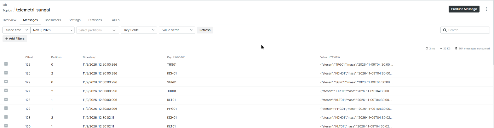

| Mode | Starts at |
|---|---|
| **Newest** | The latest messages (the default) |
| **Oldest** | The first message still kept |
| **Live** | New messages as they arrive (Topic 6) |
| **From offset** | An exact offset in the partitions you pick |
| **Since time** | The first message at or after a clock time |

### 11.2 — Jump to an exact message: partition and offset

A partition and an offset are the exact address of one message: "partition 1, offset 128" is one KLT01 reading, and it never changes.

1. Change the drop-down to **From offset** and type an offset you saw in 11.1, e.g. `128`.
2. In **Select partitions** tick **Partition #1**, then press **Enter** in the offset box.

   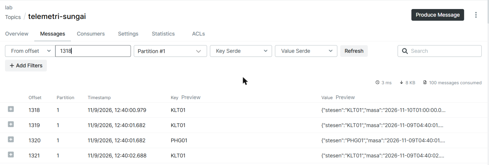

### 11.3 — Filter by what is inside

The **Search** box (Topic 6) finds text anywhere in the key or value. A **smart filter** can test the fields of the JSON.

1. Click **+ Add Filters**.
2. **Filter code:**
   ```
   record.keyAsText == 'KLT01' && record.value.paras_air > 18.05
   ```
   **Display name:** `KLT01 tinggi`. Click **Add Filter**.

   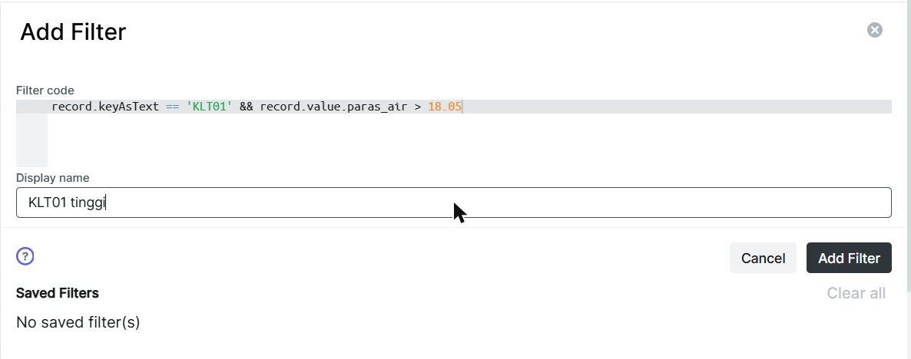

3. Only KLT01 readings above 18.05 m are left.

   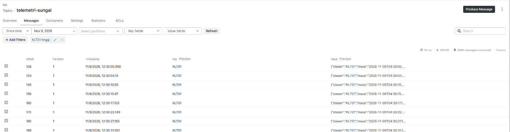

| In the filter | Means |
|---|---|
| `record.keyAsText` | The key as text, e.g. `KLT01` |
| `record.value.paras_air` | A field inside the JSON value |
| `record.partition` | The partition number |
| `record.headers['sumber']` | A header (Topic 10) |
| `&&`, `\|\|`, `==`, `>` | and, or, equals, greater than |

> **"`… errors` at the top right?"** A few readings are whole numbers, e.g. `"paras_air":18` instead of `18.0`. This filter language refuses to compare a whole number with `18.05`, so it skips those messages and counts an error. Number formats matter: you deal with messy data in code on Day 2.

4. Click the **×** on the filter to remove it.

### 11.4 — The same from the CLI

From an exact address: partition 1, offset 128, three messages. In **Kafka shell 1**:

```bash
./kafka-console-consumer.sh --bootstrap-server localhost:9092 --topic telemetri-sungai --partition 1 --offset 128 --max-messages 3 --formatter-property print.offset=true --formatter-property print.key=true
```

```
Offset:128	KLT01	{"stesen":"KLT01","masa":"2026-11-09T04:30:00.996Z","paras_air":18.08,"hujan":0.3}
Offset:129	PHG01	{"stesen":"PHG01","masa":"2026-11-09T04:30:00.996Z","paras_air":29.94,"hujan":0.6}
Offset:130	KLT01	{"stesen":"KLT01","masa":"2026-11-09T04:30:02.010Z","paras_air":18.04,"hujan":2.4}
Processed a total of 3 messages
```

From a time: ask Kafka which offset partition 1 had 10 minutes ago:

```bash
./kafka-get-offsets.sh --bootstrap-server localhost:9092 --topic telemetri-sungai --partitions 1 --time $(( $(date +%s) - 600 ))000
```

The answer, `telemetri-sungai:1:<offset>`, is the first message at or after that time. Use that offset with `--offset` in the command above. `$(( $(date +%s) - 600 ))000` is "now, minus 600 seconds", written in milliseconds.

**Try it**
1. Find your Topic 10 message by its header: a smart filter `record.headers['sumber'] == 'kafka-ui'`, with **Since time** set before you sent it.
2. `--time -2` gives the oldest offset still kept, `--time -1` the next new one. Run both for partition 1.

**Checkpoint ✅** You can find a message by time, by partition and offset, and by content, in both the Kafka UI and the CLI.

---

## Topic 12 — Topic housekeeping

**Goal:** do the everyday jobs on a running Kafka: change a setting, delete old messages, delete a topic. This is the "What can I change later?" table from Topic 4.3, by hand.

**Open:** the Kafka UI and Kafka shell 1.

### 12.1 — Change a setting while Kafka runs

In the Kafka UI:

1. Open **Topics → ujian** and click **⋮** at the top right.

   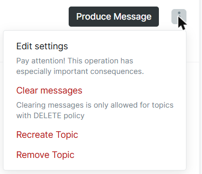

2. Click **Edit settings**. Under **Time to retain data**, click **1 day**, then **Update topic**. A green **Topic successfully updated** appears. No restart, no lost messages.

   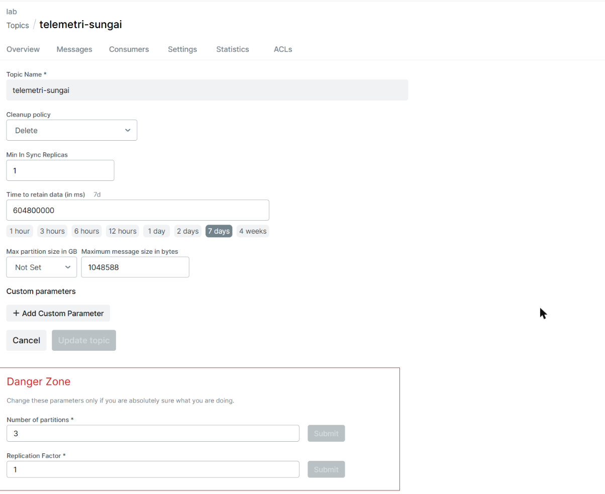

   On the same page: **Maximum message size in bytes** `1048588` is the limit from Topic 10.3. **Danger Zone** changes the number of partitions: you use it in Topic 13.

The same from the CLI. In **Kafka shell 1**:

```bash
./kafka-configs.sh --bootstrap-server localhost:9092 --alter --entity-type topics --entity-name ujian --add-config retention.ms=3600000
./kafka-configs.sh --bootstrap-server localhost:9092 --describe --entity-type topics --entity-name ujian
```

```
Completed updating config for topic ujian.
Dynamic configs for topic ujian are:
  …
  retention.ms=3600000 sensitive=false synonyms={DYNAMIC_TOPIC_CONFIG:retention.ms=3600000}
```

`retention.ms=3600000` is 1 hour. **Put it back** to the broker default (7 days):

```bash
./kafka-configs.sh --bootstrap-server localhost:9092 --alter --entity-type topics --entity-name ujian --delete-config retention.ms
```

### 12.2 — Delete old messages

Kafka cannot delete one message in the middle of a partition. It can delete **everything before an offset**, or wait for retention.

> **Real situation:** a batch of test readings was sent to the real topic by mistake, or data must be removed earlier than retention would. You remove everything before a chosen offset.

1. Delete the first two messages (offsets 0 and 1) in partition 1 of `ujian`. Every key you sent in Topic 5.5 landed there, so it has at least two. In **Kafka shell 1**:
   ```bash
   echo '{"partitions":[{"topic":"ujian","partition":1,"offset":2}],"version":1}' > /tmp/padam.json
   ./kafka-delete-records.sh --bootstrap-server localhost:9092 --offset-json-file /tmp/padam.json
   ./kafka-get-offsets.sh --bootstrap-server localhost:9092 --topic ujian --partitions 1 --time -2
   ```
   ```
   Records delete operation completed:
   partition: ujian-1	low_watermark: 2
   ujian:1:2
   ```
   The oldest message kept in partition 1 is now offset 2. Offsets are never renumbered.
2. Delete **all** messages in the Kafka UI: **Topics → ujian → ⋮ → Clear messages → Confirm**. Open **Overview**: **Message Count** `0`, and in each partition **First Offset** equals **Next Offset**. The next message continues the numbering.

   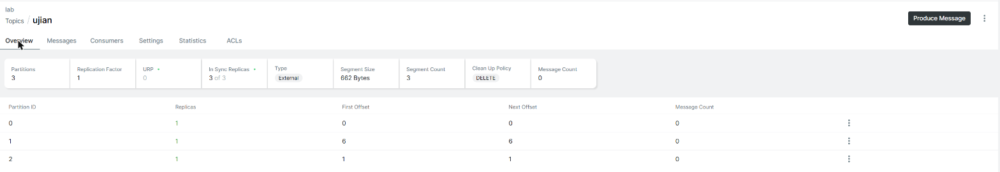

   **Clear messages** only works on topics with `cleanup.policy=delete`. On a compacted topic such as `status-stesen`, the menu tells you so.

### 12.3 — Delete a topic

`ujian-retensi` from Topic 8 is no longer needed. In **Kafka shell 1**:

```bash
./kafka-topics.sh --bootstrap-server localhost:9092 --delete --topic ujian-retensi
./kafka-topics.sh --bootstrap-server localhost:9092 --list
```

`ujian-retensi` is gone from the list. In the Kafka UI the same is **⋮ → Remove Topic**.

> **Never** delete a topic that a program still uses. There is no undo, and every consumer group loses its place. Day 2 deletes and recreates `telemetri-sungai` on purpose, to start the morning with an empty topic.

**Checkpoint ✅** You changed retention without a restart, deleted old messages and a whole topic, and saw that offsets are never reused.

---

## Topic 13 — Scale out live

**Goal:** add partitions and consumers while data flows, and see what changes, and what silently breaks.

**Open:** Kafka shells 1 and 2, the Simulator terminal and the Kafka UI. The simulator must be running.

> **Real situation:** during a big sale, payments on an e-wallet triple. The payment team wants six processors, but the topic has three partitions, so three processors would sit idle (Topic 2.2, Setup 2). They add partitions to a topic that is in use.

### 13.1 — Before: two consumers share three partitions

In **Kafka shells 1 and 2**, start a consumer in a new group `skala` (*scale*):

```bash
./kafka-console-consumer.sh --bootstrap-server localhost:9092 --topic telemetri-sungai --group skala --formatter-property print.partition=true --formatter-property print.key=true
```

In the Kafka UI open **Consumers → skala** and click **+** next to `telemetri-sungai`: 2 members share partitions 0, 1 and 2.

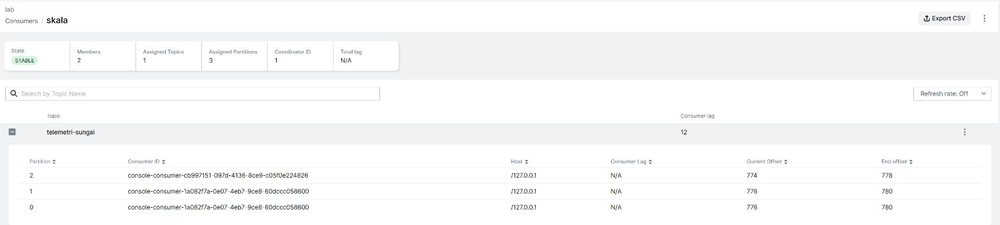

### 13.2 — Add partitions

1. In the Kafka UI open **Topics → telemetri-sungai → ⋮ → Edit settings**.
2. In **Danger Zone**, set **Number of partitions** to `6`, click **Submit**, then **Confirm**.

   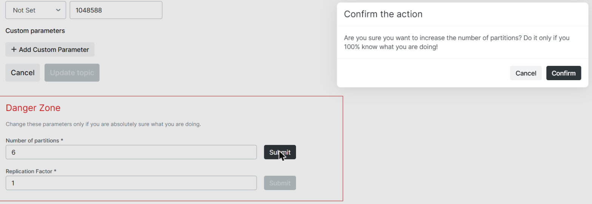

The CLI way is `./kafka-topics.sh --bootstrap-server localhost:9092 --alter --topic telemetri-sungai --partitions 6`. You can only go up, never down (Topic 4.3).

### 13.3 — Nobody notices yet

Open **Overview**: 6 partitions, but partitions 3, 4 and 5 stay at 0 messages. Open **Consumers → skala**: still only partitions 0, 1 and 2.

Producers and consumers check the number of partitions only every **5 minutes**. Restart the simulator so it sees the new partitions now: **Ctrl+C** in the Simulator terminal, then `node simulator.js` again.

### 13.4 — Some keys moved

Wait a minute and open **Overview** again.

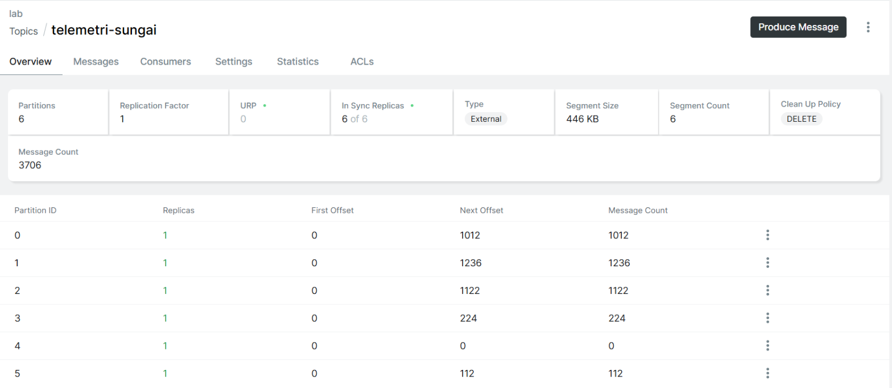

| Station | With 3 partitions | With 6 partitions |
|---|---|---|
| SGR01 | 0 | **3** |
| TRG01 | 0 | **3** |
| KLT01 | 1 | 1 |
| PHG01 | 1 | 1 |
| KDH01 | 2 | 2 |
| JHR01 | 2 | **5** |

Kafka picks the partition as *hash of the key, divided by the number of partitions, keep the remainder*. Change the number of partitions and some keys land somewhere else. SGR01's old readings are in partition 0 and its new ones in 3, so a consumer may read them out of order around the change. Partitions 0 and 4 now get nothing: six keys over six partitions still do not spread evenly.

### 13.5 — The silent gap, and the fix

Group `skala` still reads only partitions 0, 1 and 2. **SGR01, TRG01 and JHR01 now go unread**, and the lag does not even show it: partitions 3 to 5 are not in the group's list at all.

Restart both consumers: **Ctrl+C** in Kafka shells 1 and 2, then start them again **with `--from-beginning`**:

```bash
./kafka-console-consumer.sh --bootstrap-server localhost:9092 --topic telemetri-sungai --group skala --from-beginning --formatter-property print.partition=true --formatter-property print.key=true
```

`--from-beginning` only applies to partitions where the group has no bookmark yet. Partitions 0 to 2 carry on where they stopped; partitions 3 to 5 are read from their first message, so nothing is missed. Without it, the group would start the new partitions at the newest message and skip everything written there since you added them (in our test, about 130 readings).

In **Consumers → skala**: 2 members, 3 partitions each, and SGR01, TRG01 and JHR01 are read again.

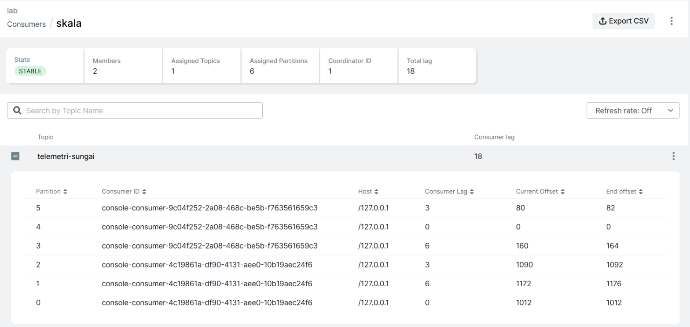

| Lesson | Why |
|---|---|
| Choose enough partitions at the start | Adding later moves keys and breaks ordering for a while |
| After adding partitions, restart producers and consumers | Or they keep using the old count for up to 5 minutes |
| Restart consumers so they read new partitions from the start | Or the messages written there in the meantime are skipped |

**Put everything back:** press **Ctrl+C** in both Kafka shells. Leave the simulator running. `telemetri-sungai` keeps 6 partitions today; Day 2 recreates it with 3.

**Checkpoint ✅** You added partitions to a live topic, saw keys move to new partitions, and restarted the consumers so no reading was missed.

---

## End of Day 1 — what you should have

- Kafka, the Kafka UI, Grafana and PostgreSQL running in Docker.
- Topics `telemetri-sungai` (6 partitions since Topic 13) and `amaran-banjir` (3), plus `ujian` and `status-stesen`. `ujian-retensi` was deleted in Topic 12.
- The station simulator streaming into `telemetri-sungai`.
- In `kafka-lab`: `docker-compose.yml`, `grafana/`, `package.json`, `node_modules/`, `kafka.js`, `stations.js`, `simulator.js`.
- You have seen: topics, keys, groups sharing partitions, lag, replay, retention and compaction, headers and timestamps, finding any message, topic housekeeping, and adding partitions to a live topic.

**Before you leave:** stop the simulator (**Ctrl+C** in its terminal), so the topic does not fill up overnight.

You can shut down your laptop. Topics and offsets are kept in the volume. Tomorrow, start Docker Desktop and run `docker compose up -d` in `kafka-lab`.

> **Never** run `docker compose down -v` unless you want to start from zero: `-v` deletes the volumes, and with them every topic and message.

**Extra, if you finish early**
1. Add a seventh station to `stations.js`, restart the simulator and find it in the Kafka UI. Which partition does it go to?
2. Run `node simulator.js --faulty`. In the Kafka UI, find the broken KDH01 reading (`"paras_air":"ERR"`). Kafka stored it without complaint: Kafka does not check what is inside a message. That is your code's job tomorrow.

**Tomorrow (Day 2):** you write the code: a producer, a consumer, then flood alerts that react to the stream, a database writer, and a live Grafana dashboard.

## Command cheat-sheet

| Task | Command |
|---|---|
| Start Kafka + Kafka UI + Grafana + PostgreSQL | `docker compose up -d` |
| Stop everything (keep data) | `docker compose stop` |
| Status / memory | `docker compose ps` / `docker stats --no-stream` |
| Follow a container's log | `docker compose logs -f kafka` |
| Start the simulator | `node simulator.js` (options: `--flood KLT01`, `--faulty`) |
| Shell inside Kafka (the `./kafka-…` commands below run there) | `docker exec -it --workdir /opt/kafka/bin kafka bash` |
| List topics | `./kafka-topics.sh --bootstrap-server localhost:9092 --list` |
| Describe a topic | `./kafka-topics.sh --bootstrap-server localhost:9092 --describe --topic telemetri-sungai` |
| Follow a topic with keys | `./kafka-console-consumer.sh --bootstrap-server localhost:9092 --topic telemetri-sungai --formatter-property print.key=true --formatter-property print.partition=true` |
| Describe a group | `./kafka-consumer-groups.sh --bootstrap-server localhost:9092 --describe --group cli-group` |
| Replay a group 5 min | `./kafka-consumer-groups.sh --bootstrap-server localhost:9092 --group <group> --topic telemetri-sungai --reset-offsets --by-duration PT5M --execute` |
| Mark everything read (skip backlog) | `./kafka-consumer-groups.sh --bootstrap-server localhost:9092 --group <group> --topic telemetri-sungai --reset-offsets --to-latest --execute` |
| Read from an exact offset | `./kafka-console-consumer.sh --bootstrap-server localhost:9092 --topic telemetri-sungai --partition 1 --offset 128 --max-messages 3` |
| Offset at a time (10 min ago) | `./kafka-get-offsets.sh --bootstrap-server localhost:9092 --topic telemetri-sungai --partitions 1 --time $(( $(date +%s) - 600 ))000` |
| Show a topic's settings | `./kafka-configs.sh --bootstrap-server localhost:9092 --describe --entity-type topics --entity-name ujian` |
| Change a topic setting | `./kafka-configs.sh --bootstrap-server localhost:9092 --alter --entity-type topics --entity-name ujian --add-config retention.ms=3600000` |
| Add partitions | `./kafka-topics.sh --bootstrap-server localhost:9092 --alter --topic telemetri-sungai --partitions 6` |
| Delete a topic | `./kafka-topics.sh --bootstrap-server localhost:9092 --delete --topic ujian-retensi` |
| Kafka UI / Grafana | `http://localhost:8085` / `http://localhost:3000` |
