# Day 2 — Code: Produce, React to Events, Dashboard

> **Yesterday you explored Kafka with tools. Today you write the code.** Eight short Node.js files: four that produce data, four that consume it and react to events. Then you save the history to a database and watch the whole flow live in Grafana.
> **Carry-over:** the `kafka-lab` folder from Day 1, with `npm install` done (Topic 6).

**Acronyms in this file:** **IoT** = Internet of Things · **CLI** = command-line interface · **UI** = user interface · **JSON** = JavaScript Object Notation · **SMS** = Short Message Service · **SQL** = Structured Query Language · **TLS** = Transport Layer Security · **SASL** = Simple Authentication and Security Layer · **ACL** = access control list

> **Names in the code:** functions, variables and files are in English. The data stays as the stations send it: message fields (`stesen`, `masa`, `paras_air`, `hujan`), topic names and status values (`WASPADA`, `AMARAN`, `BAHAYA`) are in Bahasa Malaysia.

## Before you start

1. Start Docker Desktop, then in `kafka-lab`:
   ```powershell
   docker compose up -d
   ```
2. **Start `telemetri-sungai` from empty**, so your first consumer does not print yesterday's hundred thousand readings:
   ```powershell
   docker exec kafka /opt/kafka/bin/kafka-topics.sh --bootstrap-server localhost:9092 --delete --topic telemetri-sungai
   docker exec kafka /opt/kafka/bin/kafka-topics.sh --bootstrap-server localhost:9092 --create --topic telemetri-sungai --partitions 3
   ```
3. Check in the Kafka UI (`http://localhost:8085`): **Topics** lists `telemetri-sungai` (0 messages) and `amaran-banjir`.
4. Keep the simulator **stopped** until Topic 18.

**Today's files:**

| Produce (4 files) | Consume and react (4 files) |
|---|---|
| `kafka.js`: the connection, shared by every file (from Day 1) | `consumer.js`: read readings, share the work in a group |
| `stations.js`: the six stations and their warning levels (from Day 1) | `alert.js`: readings → flood alerts |
| `producer.js`: your first producer | `notifier.js`: flood alerts → an SMS |
| `simulator.js`: the six stations, every second (from Day 1) | `db-writer.js`: readings → PostgreSQL |

**Today's pipeline:**

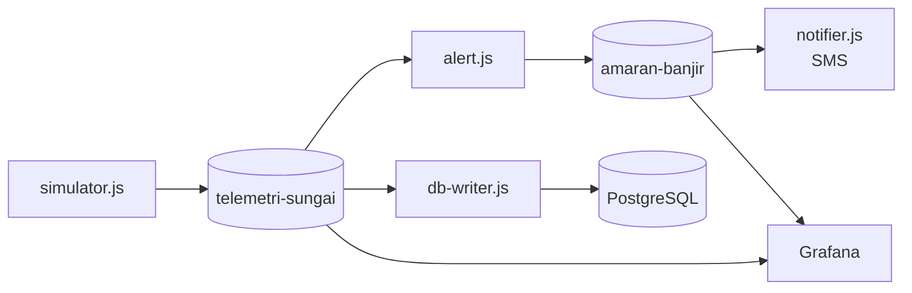

---

## Topic 14 — Build a producer: send JSON sensor readings

**Goal:** a Node.js program that sends river readings to `telemetri-sungai` as JSON.

### 14.1 — The shared connection settings

Open `kafka.js`, which the simulator already used yesterday. Every program today imports it:

```javascript
// One place for the Kafka connection settings. Every lab file uses this.
import { Kafka, logLevel } from 'kafkajs';

// KafkaJS 2 warns that its default partitioner changed. We want the new one, so hide the warning.
process.env.KAFKAJS_NO_PARTITIONER_WARNING = '1';

export const kafka = new Kafka({ clientId: 'kafka-lab', brokers: ['localhost:9092'], logLevel: logLevel.WARN });
export const TOPIC = 'telemetri-sungai';

// On Ctrl+C, leave Kafka cleanly so the consumer group rebalances at once
export function disconnectOnExit(...clients) {
  const stop = async () => {
    for (const client of clients) await client.disconnect();
    process.exit(0);
  };
  process.on('SIGINT', stop);
  process.on('SIGTERM', stop);
}
```

| Piece | What it does |
|---|---|
| `import` / `export` | The lab files are JavaScript modules (`"type": "module"` in `package.json`). That lets you use `await` at the top level of a file, with no `main()` function around it. |
| `KAFKAJS_NO_PARTITIONER_WARNING` | KafkaJS picks partitions the same way the Kafka CLI and Java clients do. That is what we want; this line just hides a warning about it. |
| `brokers: ['localhost:9092']` | Where to find Kafka. A production list names several brokers, so the program can start when one is down. |
| `clientId` | A name for your program. It shows in the Kafka UI and in broker logs. |
| `logLevel: logLevel.WARN` | Only show warnings and errors from KafkaJS |
| `TOPIC` | The topic name in one place, so a typo can only happen once |
| `disconnectOnExit()` | On **Ctrl+C**, tell Kafka you are leaving. Every consumer today calls it. |

### 14.2 — The producer

Create `producer.js`:

```javascript
// Topic 14: send JSON river readings to Kafka.
import { kafka, TOPIC } from './kafka.js';

const STATIONS = ['KLT01'];
const producer = kafka.producer();
await producer.connect();

for (let round = 1; round <= 5; round++) {
  for (const station of STATIONS) {
    const reading = {
      stesen: station,
      masa: new Date().toISOString(),
      paras_air: Number((18 + Math.random()).toFixed(2)),
      hujan: Number((Math.random() * 5).toFixed(1)),
    };
    const [result] = await producer.send({
      topic: TOPIC,
      messages: [{ value: JSON.stringify(reading) }],
    });
    console.log(`${station} → partition ${result.partition}, offset ${result.baseOffset}  paras_air=${reading.paras_air}`);
  }
  await new Promise((resolve) => setTimeout(resolve, 1000));
}

await producer.disconnect();
```

| Piece | What it does |
|---|---|
| `kafka.producer()` | Creates a producer, with the settings from `kafka.js` |
| `await producer.connect()` | Top-level `await`: the file waits here until it is connected |
| `reading` | One reading. `masa` is in UTC (the `Z` at the end); convert to Malaysia time only when you display it. |
| `producer.send({ topic, messages })` | Sends a list of messages. You can send many in one call. |
| `value: JSON.stringify(reading)` | Kafka stores bytes, not objects. Turn the object into a JSON string first. |
| `result.partition`, `result.baseOffset` | Where Kafka stored the message |
| `setTimeout` inside a `Promise` | Wait one second between rounds |
| `producer.disconnect()` | Sends anything still waiting and closes the connection |

Run it:

```powershell
node producer.js
```

```
KLT01 → partition 2, offset 0  paras_air=18.75
KLT01 → partition 0, offset 0  paras_air=18.19
KLT01 → partition 1, offset 0  paras_air=18.67
KLT01 → partition 2, offset 1  paras_air=18.23
KLT01 → partition 0, offset 1  paras_air=18.31
```

Your partition order will differ. Notice that **one station's readings are spread over all three partitions.** Keep that in mind for Topic 16.

> **Seeing `TimeoutNegativeWarning: … is a negative number`?** A harmless warning from KafkaJS on newer Node.js versions. Run `node --no-warnings producer.js` to hide it.

**Try it**
1. Open the Kafka UI, **Topics → telemetri-sungai → Messages**. Your five readings are there, with no key.

   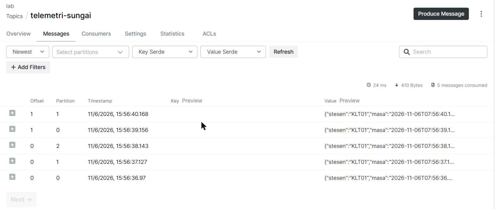

2. Change `round <= 5` to `round <= 10` and `1000` to `500`. Run again: ten readings, twice as fast.
3. **Break it on purpose.** In `producer.send`, change `topic: TOPIC` to `topic: 'telemetri-sunagi'` and run. After some seconds of retries, Node.js stops the program with:
   ```
   KafkaJSNonRetriableError
     Caused by: KafkaJSProtocolError: This server does not host this topic-partition
   ```
4. **Put everything back:** `topic: TOPIC`, `round <= 5`, `1000`.

**Checkpoint ✅** `node producer.js` prints five readings with their partition and offset, and the Kafka UI shows them.

---

## Topic 15 — Build a consumer: read messages, and scale with consumer groups

**Goal:** a consumer that reads the readings, then two copies of it sharing the work, as the CLI consumers did in Day 1, Topic 7.

Create `consumer.js`:

```javascript
// Topic 15: read river readings. Run it twice with the same group to share the work.
// Usage: node consumer.js [group]      e.g. node consumer.js group-a
import { kafka, TOPIC, disconnectOnExit } from './kafka.js';

const groupId = process.argv[2] || 'group-a';
const consumer = kafka.consumer({ groupId });
await consumer.connect();
await consumer.subscribe({ topic: TOPIC, fromBeginning: true });
disconnectOnExit(consumer);
console.log(`Group "${groupId}" is listening on ${TOPIC}... (Ctrl+C to stop)`);

await consumer.run({
  eachMessage: async ({ partition, message }) => {
    const key = message.key ? message.key.toString() : '(no key)';
    const reading = JSON.parse(message.value.toString());
    console.log(`p${partition} offset ${message.offset}  key=${key}  ${reading.stesen} paras_air=${reading.paras_air}`);
  },
});
```

| Piece | What it does |
|---|---|
| `process.argv[2]` | The first word after `node consumer.js`: the group name |
| `groupId` | The consumer group. Consumers with the same `groupId` share the partitions. |
| `fromBeginning: true` | For a **new** group only: start at the oldest message. A group that has run before always continues from its committed offset. |
| `disconnectOnExit(consumer)` | On **Ctrl+C**, tell Kafka you are leaving so the group rebalances straight away |
| `consumer.run({ eachMessage })` | **Event-driven:** KafkaJS calls `eachMessage` once for every message, as it arrives, in order within each partition. You never ask "is there anything new?". |
| `message.value.toString()` | Kafka gives you bytes. Turn them into a string, then `JSON.parse` |

### 15.1 — One consumer

```powershell
node consumer.js
```

```
Group "group-a" is listening on telemetri-sungai... (Ctrl+C to stop)
p0 offset 0  key=(no key)  KLT01 paras_air=18.19
p0 offset 1  key=(no key)  KLT01 paras_air=18.31
p1 offset 0  key=(no key)  KLT01 paras_air=18.67
...
```

It reads everything already in the topic, then waits. Leave it running.

> **Seeing red `ERROR` lines such as `The group coordinator is not available` or `The group is rebalancing, so a rejoin is needed`?** These appear when a group starts or members join and leave. KafkaJS logs them at ERROR level, but they are normal and it handles them itself. Worry only if no messages arrive after about 30 seconds.

### 15.2 — Two consumers in the same group

1. Open a **second** terminal and run the same command: `node consumer.js`.
2. Open a **third** terminal and run `node producer.js`.
3. Compare terminals 1 and 2. Each consumer only gets messages from **its own** partitions.
4. In the Kafka UI click **Consumers → group-a**, then **+** next to the topic: two members, and which partitions each owns.

   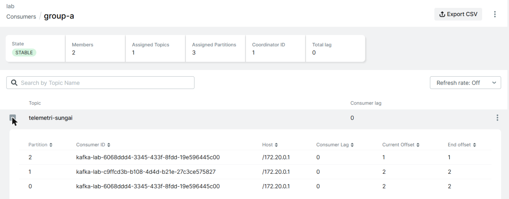

### 15.3 — A second group gets its own copy

In the third terminal:

```powershell
node consumer.js group-b
```

`group-b` is new, so it reads **every** message from the beginning, even though `group-a` already read them. **Rule: one group per job.** The alert service and the dashboard both need every reading, so they are two groups.

**Try it**
1. With two `group-a` consumers running, press **Ctrl+C** in one. Run `node producer.js` again. The remaining consumer now gets all partitions.
2. **Break it on purpose: a poison message.** Send rubbish into the topic from the Kafka UI: **Topics → telemetri-sungai → Produce Message**, leave **Partition** and **Key** as they are, **Value** `bukan json`, click **Produce Message**.

   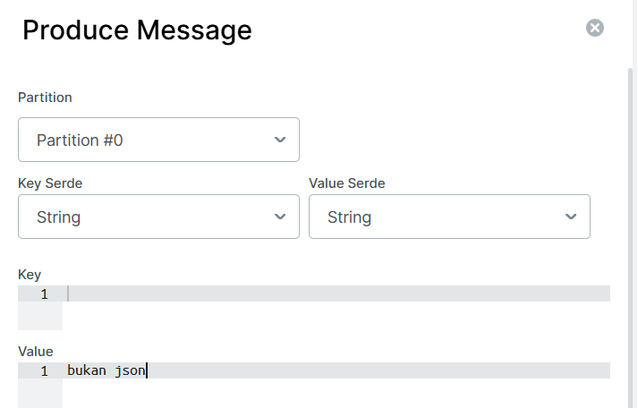

   Watch the `group-a` consumer:
   ```
   {"level":"ERROR",…,"message":"[Consumer] Crash: KafkaJSNonRetriableError: Unexpected token 'b', \"bukan json\" is not valid JSON","groupId":"group-a",…}
   ```
   `JSON.parse` threw an error, and the program stopped. Start it again: `node consumer.js`. It crashes **again** at once. The bad message was never committed, so the group goes back to it every time. One bad message now blocks every reading behind it.
3. **Put everything back** by making the consumer skip what it cannot read. Replace the body of `eachMessage` with:
   ```javascript
       const key = message.key ? message.key.toString() : '(no key)';
       try {
         const reading = JSON.parse(message.value.toString());
         console.log(`p${partition} offset ${message.offset}  key=${key}  ${reading.stesen} paras_air=${reading.paras_air}`);
       } catch (error) {
         // Skip a message we cannot read instead of stopping (Topic 15, Try it)
         console.log(`p${partition} offset ${message.offset}  SKIPPED: ${error.message}`);
       }
   ```
   Run `node consumer.js` again. It prints `SKIPPED: Unexpected token 'b', "bukan json" is not valid JSON` and carries on. The finished file is in [`code/consumer.js`](code/consumer.js).
4. Press **Ctrl+C** in every consumer terminal.

**Checkpoint ✅** You have seen two of your own consumers share the partitions, a second group receive all messages, and your consumer survive a message that is not JSON.

---

## Topic 16 — Keys, partitions and ordering

**Goal:** make sure all readings from one station stay in order, by giving each message a key.

### 16.1 — The problem

In Topic 14, KLT01's readings went to all three partitions in turn. With two consumers in a group, some KLT01 readings go to consumer 1 and some to consumer 2. They run in parallel, so an alert service could see:

```
consumer 2: KLT01 23.4 m   (reading from 10:00:02)
consumer 1: KLT01 23.1 m   (reading from 10:00:01, processed later)
```

It now thinks the river is **falling** when it is rising. Kafka only keeps order **inside one partition**.

### 16.2 — The fix: use the station ID as the key

Kafka sends every message with the same key to the same partition: `partition = hash(key) % number of partitions`. One station → one partition → one consumer → readings in order.

Change two lines in `producer.js`:

```javascript
const STATIONS = ['KLT01', 'PHG01', 'SGR01'];
```

```javascript
      messages: [{ key: station, value: JSON.stringify(reading) }],
```

Also change the comment at the top to `// Topic 14 + 16: send JSON river readings to Kafka, one message per station.` The finished file is in [`code/producer.js`](code/producer.js).

Run it:

```powershell
node producer.js
```

```
KLT01 → partition 1, offset 2  paras_air=18.87
PHG01 → partition 1, offset 3  paras_air=18.71
SGR01 → partition 0, offset 2  paras_air=18.23
...
```

KLT01 always goes to partition 1, PHG01 also to partition 1, and SGR01 to partition 0. Your offsets will differ, but the partitions will be the same: the hash gives the same answer on every computer. They also match where the simulator and the Kafka CLI put these keys on Day 1.

**Try it**
1. Notice that **partition 2 gets nothing.** With few keys, the hash can put several on one partition and leave another empty. This is called **skew**. Add `'KDH01'` to the `STATIONS` list and run again: KDH01 goes to partition 2.
2. Run `node consumer.js group-c` and look at the `key=` column. Every KLT01 line shows the same `p` number.

> **Later, in production:** the key → partition mapping depends on the number of partitions. If you add partitions to a topic later, keys move to different partitions and ordering breaks during the change. Choose the partition count up front.

**Checkpoint ✅** Every reading from the same station lands in the same partition.

---

## Topic 17 — Delivery and offsets in practice: at-least-once

**Goal:** know what your consumer's committed offset protects, and why a message can arrive twice.

### 17.1 — Committing an offset

A consumer regularly tells Kafka "I have finished everything before this point". That is its **committed offset**, the number you saw as `CURRENT-OFFSET` on Day 1. If the consumer restarts, it continues from there.

1. Run `node consumer.js group-d`. It reads everything. Press **Ctrl+C**.
2. Run `node producer.js` (15 new readings).
3. Run `node consumer.js group-d` again. Only the **15 new** readings appear: the group remembered its place.
4. In the Kafka UI, open **Consumers → group-d**: **Total lag** 0, and 0 on every partition. Press **Ctrl+C**.

   

### 17.2 — Three guarantees

KafkaJS commits **after** your `eachMessage` has finished, a batch at a time. So if the program crashes after processing a message but before the commit, that message is **processed again** after the restart.

| Guarantee | How | After a crash |
|---|---|---|
| **At-most-once** | Commit **before** processing | The message being processed is lost |
| **At-least-once** | Commit **after** processing (KafkaJS default) | The message being processed is repeated |
| **Exactly-once** | Kafka transactions | Neither, but more complex and not supported well in KafkaJS (beyond this course) |

For flood readings, a lost reading is worse than a repeated one, so at-least-once is the right choice. The price: **your code must be safe when a message arrives twice.**

**Try it**
1. Replay `group-d` from the start, as on Day 1:
   ```powershell
   docker exec kafka /opt/kafka/bin/kafka-consumer-groups.sh --bootstrap-server localhost:9092 --group group-d --topic telemetri-sungai --reset-offsets --to-earliest --execute
   ```
   Run `node consumer.js group-d`: every reading again. This is what a crash or a replay does. Now imagine the consumer sent an SMS for each reading above Bahaya. Keep that thought for Topic 19.

**Checkpoint ✅** You can explain why a restarted consumer continues where it stopped, and why at-least-once means a message can be processed twice.

---

## Topic 18 — The station simulator: a real producer

**Goal:** read the simulator you have run since yesterday, and use it to stream live, realistic data.

Open `simulator.js`. It is the same producer as yours, plus a timer:

```javascript
// Topic 18: simulates the river stations, one reading per station every second.
//   node simulator.js                  normal weather
//   node simulator.js --flood KLT01    heavy rain at KLT01: its water level keeps rising
//   node simulator.js --faulty         also sends one broken reading (a sensor error)
import { kafka, TOPIC, disconnectOnExit } from './kafka.js';
import { STATIONS } from './stations.js';

const args = process.argv.slice(2);
const floodStation = args.includes('--flood') ? args[args.indexOf('--flood') + 1] : null;
const sendFaulty = args.includes('--faulty');

const producer = kafka.producer();
await producer.connect();
disconnectOnExit(producer);

const levels = Object.fromEntries(STATIONS.map((station) => [station.id, station.normal]));
let round = 0;

function newReading(station) {
  const flooding = station.id === floodStation;
  levels[station.id] = flooding
    ? Math.min(levels[station.id] + 0.05, station.danger + 1) // rises 0.05 m per reading
    : station.normal + (Math.random() - 0.5) * 0.2; // wanders a little around normal
  const reading = {
    stesen: station.id,
    masa: new Date().toISOString(),
    paras_air: Number(levels[station.id].toFixed(2)),
    hujan: Number((flooding ? 20 + Math.random() * 40 : Math.random() * 3).toFixed(1)),
  };
  return { key: station.id, value: JSON.stringify(reading) };
}

console.log(`Simulator started: ${STATIONS.length} stations, every second. Ctrl+C to stop.`);
setInterval(async () => {
  round++;
  const messages = STATIONS.map(newReading);
  if (sendFaulty && round === 5) {
    const faulty = { stesen: 'KDH01', masa: new Date().toISOString(), paras_air: 'ERR', hujan: null };
    messages.push({ key: 'KDH01', value: JSON.stringify(faulty) });
    console.log('⚠️  Sent a faulty reading from KDH01:', JSON.stringify(faulty));
  }
  try {
    await producer.send({ topic: TOPIC, messages });
    console.log(`[${new Date().toLocaleTimeString('en-MY')}] sent ${messages.length} readings`);
  } catch (error) {
    console.error('Send failed:', error.message);
  }
}, 1000);
```

| Piece | What it does |
|---|---|
| `import { STATIONS } from './stations.js'` | The six stations with their normal, Waspada, Amaran and Bahaya levels |
| `process.argv.slice(2)` | The options after `node simulator.js`, e.g. `--flood KLT01` |
| `levels` | The current water level of each station, starting at its normal level |
| `newReading()` | Builds one reading. A flooding station rises 0.05 m per second; the others wander a little. |
| `key: station.id` | The key from Topic 16: each station stays in one partition |
| `setInterval(…, 1000)` | Every second, send one reading per station |
| `STATIONS.map(newReading)` | Six messages, sent in **one** `producer.send` call |
| `--faulty` | In round 5, also sends a broken KDH01 reading: `"paras_air": "ERR"`. Real sensors do this. |
| `try … catch` around `send` | If Kafka is down, print `Send failed` and try again next second, instead of stopping |

Start it in its own terminal, with a flood at Kuala Krai and a faulty sensor:

```powershell
node simulator.js --flood KLT01 --faulty
```

```
Simulator started: 6 stations, every second. Ctrl+C to stop.
[3:15:21 pm] sent 6 readings
...
⚠️  Sent a faulty reading from KDH01: {"stesen":"KDH01","masa":"…","paras_air":"ERR","hujan":null}
[3:15:25 pm] sent 7 readings
```

Leave it running for the rest of the day. KLT01 starts at 18 m and reaches Waspada (21 m) after about a minute, Amaran (23 m) after about 1½ minutes and Bahaya (25 m) after about 2½ minutes.

**Try it**
1. In the Kafka UI (**Topics → telemetri-sungai → Messages**), search for `ERR` and click **+** on the row. The faulty reading is in Kafka like any other message. Kafka does not check what is inside a message: the consumer must.

   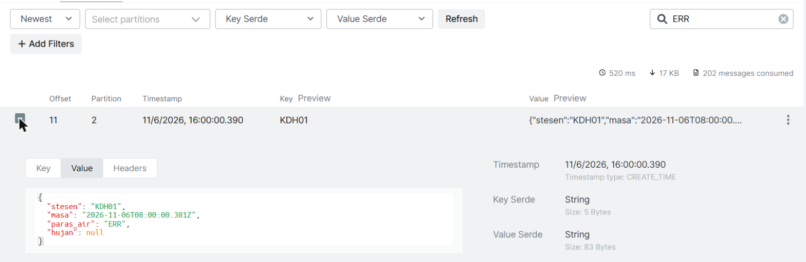

**Checkpoint ✅** The simulator streams six stations every second, with KLT01 rising and one faulty KDH01 reading sent.

---

## Topic 19 — React to events: threshold alerts on a second topic

**Goal:** a program that watches every reading and publishes a flood alert to `amaran-banjir` the moment a station's status changes, without crashing on bad data.

This is **event-driven processing**: a consumer and a producer in one program. Each reading is an event, and the program reacts to it.

| Move | Meaning | In `alert.js` |
|---|---|---|
| **Filter** | Drop messages you cannot use | Skip readings that are not JSON, have an unknown station, or a `paras_air` that is not a number |
| **Transform** | Turn a reading into new information | Work out the status: NORMAL, WASPADA, AMARAN or BAHAYA |
| **Route** | Send the result to another topic | Status changed → an alert on `amaran-banjir` |

### 19.1 — Keep alerts longer

Alerts are few and important. Keep them for 30 days instead of 7:

```powershell
docker exec kafka /opt/kafka/bin/kafka-configs.sh --bootstrap-server localhost:9092 --alter --entity-type topics --entity-name amaran-banjir --add-config retention.ms=2592000000
```

### 19.2 — The alert program

Create `alert.js`:

```javascript
// Topic 19: watch every reading and publish a flood alert when a station's status changes.
//   telemetri-sungai → alert.js → amaran-banjir
import { kafka, TOPIC, disconnectOnExit } from './kafka.js';
import { findStation, levelStatus } from './stations.js';

const consumer = kafka.consumer({ groupId: 'alert' });
const producer = kafka.producer();
await consumer.connect();
await producer.connect();
await consumer.subscribe({ topic: TOPIC });
disconnectOnExit(consumer, producer);
console.log('Watching river levels... (Ctrl+C to stop)');

const lastStatus = {}; // the last status of each station

// Returns the reading, or null if it is not a usable reading. Never throws.
function readReading(value) {
  try {
    const reading = JSON.parse(value.toString());
    return findStation(reading.stesen) && typeof reading.paras_air === 'number' ? reading : null;
  } catch {
    return null;
  }
}

await consumer.run({
  eachMessage: async ({ message }) => {
    const reading = readReading(message.value);
    if (!reading) {
      console.log(`SKIP    bad reading: ${message.value.toString()}`);
      return;
    }

    const station = findStation(reading.stesen);
    const status = levelStatus(station, reading.paras_air);
    const previous = lastStatus[station.id];
    lastStatus[station.id] = status;

    // Alert only when the status changes, not on every reading
    if (status === previous || (!previous && status === 'NORMAL')) return;

    const alert = { stesen: station.id, lokasi: station.location, dari: previous || 'TIDAK DIKETAHUI', kepada: status, paras_air: reading.paras_air, masa: reading.masa };
    await producer.send({ topic: 'amaran-banjir', messages: [{ key: station.id, value: JSON.stringify(alert) }] });
    console.log(`AMARAN  ${station.id} ${station.location}: ${alert.dari} → ${status} (${reading.paras_air} m)`);
  },
});
```

| Piece | What it does |
|---|---|
| `groupId: 'alert'` | Its own group: it gets every reading, whatever other programs read |
| `subscribe({ topic })` with no `fromBeginning` | A new alert service starts with new readings, not last week's |
| `readReading()` | **Filter.** Returns `null` for anything unusable, and **never throws**, so a bad message cannot stop the stream (the poison message from Topic 15) |
| `findStation()`, `levelStatus()` | From `stations.js`: the station's details, and its status for this level |
| `lastStatus` | Remembers each station's last status **in memory**. This is **state**: the program remembers something between messages. |
| `status === previous` → `return` | Alert on a **change** only. One reading per second at BAHAYA must not send 3,600 alerts an hour. |
| `!previous && status === 'NORMAL'` | The first reading after a start is not a change, unless it is already above normal |
| `dari: previous \|\| 'TIDAK DIKETAHUI'` | If the program has just started, it does not know the previous status |
| `producer.send({ topic: 'amaran-banjir', … })` | **Route:** the alert goes to its own topic, keyed by station |

### 19.3 — Run it

With the simulator (`--flood KLT01 --faulty`) still running, open a new terminal:

```powershell
node alert.js
```

Restart the simulator (**Ctrl+C**, then `node simulator.js --flood KLT01 --faulty` again) so the flood starts from normal. Within about 2½ minutes:

```
Watching river levels... (Ctrl+C to stop)
SKIP    bad reading: {"stesen":"KDH01","masa":"…","paras_air":"ERR","hujan":null}
AMARAN  KLT01 Kuala Krai: NORMAL → WASPADA (21 m)
AMARAN  KLT01 Kuala Krai: WASPADA → AMARAN (23 m)
AMARAN  KLT01 Kuala Krai: AMARAN → BAHAYA (25 m)
```

Open **Topics → amaran-banjir → Messages** in the Kafka UI: the alerts, keyed `KLT01`, all in partition 1.

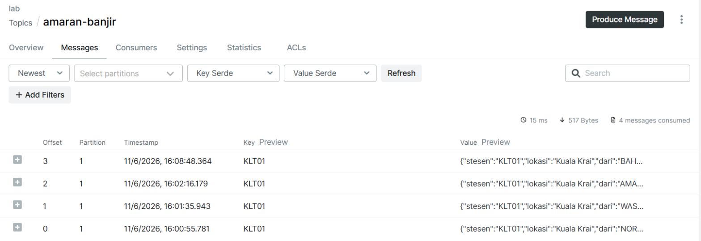

The picture has a fourth alert at the top (`BAHAYA → NORMAL`): the simulator was restarted after the flood, so KLT01 dropped back to normal.

**Try it**
1. While KLT01 is at BAHAYA, stop `alert.js` and start it again. Its memory is empty, so the first KLT01 reading gives `TIDAK DIKETAHUI → BAHAYA`. That is the correct, safe behaviour: when in doubt, alert.
2. Start a **second** `node alert.js` in another terminal. The group `alert` now has two members, each with some partitions. Is each station's status still right? Yes: every station is keyed to one partition (Topic 16), so each station's history lives in exactly one program. **Keys are what make stateful processing scale.** Stop the second one.
3. Send rubbish from the Kafka UI again (**Produce Message**, **Value** `bukan json`). `alert.js` prints `SKIP` and carries on.

**Checkpoint ✅** One KLT01 flood produced exactly three alerts in `amaran-banjir`, and the faulty KDH01 reading was skipped without stopping the program.

---

## Topic 20 — React to the alerts: a notifier

**Goal:** a second event-driven program that reacts to flood alerts, without any change to `alert.js`.

Create `notifier.js`:

```javascript
// Topic 20: react to flood alerts. Its own consumer group, so it gets every alert.
//   amaran-banjir → notifier.js → an SMS (here: a line on the screen)
import { kafka, disconnectOnExit } from './kafka.js';

const consumer = kafka.consumer({ groupId: 'notifier' });
await consumer.connect();
await consumer.subscribe({ topic: 'amaran-banjir' });
disconnectOnExit(consumer);
console.log('Waiting for flood alerts... (Ctrl+C to stop)');

await consumer.run({
  eachMessage: async ({ message }) => {
    const alert = JSON.parse(message.value.toString());
    const time = new Date(alert.masa).toLocaleTimeString('en-MY');
    if (alert.kepada === 'AMARAN' || alert.kepada === 'BAHAYA') {
      console.log(`📱 SMS to ${alert.lokasi} district office: ${alert.stesen} is at ${alert.kepada}, ${alert.paras_air} m (${time})`);
    } else {
      console.log(`   ${alert.stesen}: ${alert.dari} → ${alert.kepada}, no SMS needed (${time})`);
    }
  },
});
```

| Piece | What it does |
|---|---|
| `subscribe({ topic: 'amaran-banjir' })` | Reads the alerts, not the raw readings. `alert.js` already did the hard work. |
| `groupId: 'notifier'` | Its own group, so adding it takes nothing away from anyone else |
| `alert.kepada === 'AMARAN' \|\| … 'BAHAYA'` | Only the serious levels send an SMS. A real program would call an SMS service here. |
| `toLocaleTimeString('en-MY')` | Converts the UTC time in the alert to Malaysia time for people to read |
| No `try … catch` | Only `alert.js` writes to this topic, and it always writes valid JSON. Readings from the field are untrusted; your own alerts are trusted. |

Run it in a new terminal, with the simulator and `alert.js` still running. Restart the simulator with `--flood KLT01` to see a new flood:

```powershell
node notifier.js
```

```
Waiting for flood alerts... (Ctrl+C to stop)
   KLT01: NORMAL → WASPADA, no SMS needed (3:16:21 pm)
📱 SMS to Kuala Krai district office: KLT01 is at AMARAN, 23 m (3:17:01 pm)
📱 SMS to Kuala Krai district office: KLT01 is at BAHAYA, 25 m (3:17:41 pm)
```

This is the big benefit of Kafka from Day 1, Topic 3: **you added a new service without touching the others.** The stations, the simulator and `alert.js` did not change.

**Try it**
1. Stop `notifier.js` while KLT01 is flooding, wait for an alert to appear in `alert.js`, then start the notifier again. It sends the SMS it missed: its group remembered where it stopped (Topic 17).
2. **Think:** reset the `notifier` group to the earliest offset and start it. What happens to the district officer's phone? Every old SMS is sent again. In a real system, the notifier would remember which alerts it has already sent (for example by `stesen` + `masa`) and skip repeats. That is "safe when a message arrives twice" from Topic 17.

**Checkpoint ✅** `notifier.js` prints an SMS line for AMARAN and BAHAYA, and only a short line for WASPADA.

---

## Topic 21 — Save to a database: PostgreSQL

**Goal:** keep every reading in PostgreSQL for reports, safely: no duplicates after a replay, no gaps after a database restart.

Kafka keeps readings for 7 days. The district office wants years of history and SQL reports. A consumer that writes each reading to a database is called a **sink**. The `postgres` container is already running (`docker compose ps`), and `pg`, the PostgreSQL client for Node.js, was installed with KafkaJS on Day 1 (it is in `package.json`).

### 21.1 — The database writer

Create `db-writer.js`:

```javascript
// Topic 21: save every reading to PostgreSQL, so the history is kept for reports.
//   telemetri-sungai → db-writer.js → table bacaan
import pg from 'pg';
import { kafka, TOPIC, disconnectOnExit } from './kafka.js';
import { findStation } from './stations.js';

// Lab-only connection details, matching docker-compose.yml
const database = new pg.Pool({ host: 'localhost', port: 5433, user: 'kafka', password: 'kafka-lab', database: 'sungai' });
// Without this, a database restart crashes the whole program through an idle connection
database.on('error', (error) => console.warn('Database connection lost:', error.message));

// One row per reading. The primary key makes it impossible to save the same reading twice.
await database.query(`CREATE TABLE IF NOT EXISTS bacaan (
  stesen    TEXT          NOT NULL,
  masa      TIMESTAMPTZ   NOT NULL,
  paras_air NUMERIC(6, 2) NOT NULL,
  hujan     NUMERIC(6, 1),
  PRIMARY KEY (stesen, masa)
)`);
const INSERT = 'INSERT INTO bacaan (stesen, masa, paras_air, hujan) VALUES ($1, $2, $3, $4) ON CONFLICT (stesen, masa) DO NOTHING';

const consumer = kafka.consumer({ groupId: 'db-writer' });
await consumer.connect();
await consumer.subscribe({ topic: TOPIC, fromBeginning: true });
disconnectOnExit(consumer);
console.log('Saving readings to PostgreSQL... (Ctrl+C to stop)');

let saved = 0;
let alreadyThere = 0;

await consumer.run({
  eachMessage: async ({ message, heartbeat }) => {
    let reading;
    try {
      reading = JSON.parse(message.value.toString());
    } catch {
      return; // bad data: skip it, as alert.js does
    }
    if (!findStation(reading.stesen) || typeof reading.paras_air !== 'number') return;

    // A database that is down is a temporary problem: wait and try again, never skip the reading
    for (;;) {
      try {
        const result = await database.query(INSERT, [reading.stesen, reading.masa, reading.paras_air, reading.hujan]);
        if (result.rowCount === 1) saved++;
        else alreadyThere++;
        return;
      } catch (error) {
        console.warn(`Database not reachable (${error.code || error.message}). Trying again in 2 s`);
        await new Promise((resolve) => setTimeout(resolve, 2000));
        await heartbeat(); // tell Kafka this consumer is still alive while it waits
      }
    }
  },
});

setInterval(() => console.log(`Saved ${saved} new rows, ${alreadyThere} already there`), 5000);
```

| Piece | What it does |
|---|---|
| `pg.Pool` | A set of reusable database connections |
| `database.on('error', …)` | When PostgreSQL restarts, it drops idle connections. Without this line, Node.js treats that as a fatal error and the whole program crashes. |
| `CREATE TABLE IF NOT EXISTS` | Creates the table the first time; does nothing after that |
| `PRIMARY KEY (stesen, masa)` | One station cannot have two readings at the same moment |
| `fromBeginning: true` | Save the whole history still in Kafka, not only new readings |
| `$1 … $4` | Parameters, never string concatenation: this blocks SQL injection |
| `ON CONFLICT (stesen, masa) DO NOTHING` | A repeated reading is ignored. **This is the answer to "a message can arrive twice" from Topic 17.** |
| The bad-data `return`s | **Permanent** problem (rubbish data): trying again will never help, so skip it |
| `for (;;)` with `catch` | **Temporary** problem (database down): skipping would lose the reading, so wait 2 seconds and try again, as long as it takes |
| `heartbeat()` | While waiting, tell Kafka the consumer is alive, so the group does not hand its partitions to someone else |
| `result.rowCount` | `1` = a new row was saved, `0` = it was already there |

### 21.2 — Run it

With the simulator running, in a new terminal:

```powershell
node db-writer.js
```

```
Saving readings to PostgreSQL... (Ctrl+C to stop)
Saved 1714 new rows, 0 already there
Saved 1744 new rows, 0 already there
```

The first number is large: it saves everything still in the topic, then 6 rows a second. Look at the data with SQL:

```powershell
docker exec postgres psql -U kafka -d sungai -c "SELECT stesen, count(*) AS bacaan, max(paras_air) AS tertinggi FROM bacaan GROUP BY stesen ORDER BY stesen;"
```

```
 stesen | bacaan | tertinggi
--------+--------+-----------
 JHR01  |    589 |      3.10
 KDH01  |    589 |      6.10
 KLT01  |    589 |     26.00
 ...
```

Each station's reading count and its highest level. KLT01's 26 m is the flood from Topic 19. The faulty KDH01 reading is not there: `db-writer.js` skipped it.

**Try it**
1. **Replay without duplicates.** Stop `db-writer.js` (**Ctrl+C**), reset its group to the start, and run it again:
   ```powershell
   docker exec kafka /opt/kafka/bin/kafka-consumer-groups.sh --bootstrap-server localhost:9092 --group db-writer --topic telemetri-sungai --reset-offsets --to-earliest --execute
   node db-writer.js
   ```
   ```
   Saved 78 new rows, 2298 already there
   ```
   Every reading was delivered **again**, and not one was saved twice. The few new rows are readings that arrived while the writer was stopped.
2. **Break it on purpose.** With the writer running, stop the database: `docker compose stop postgres`. The writer prints:
   ```
   Database connection lost: terminating connection due to administrator command
   Database not reachable (Connection terminated unexpectedly). Trying again in 2 s
   Database not reachable (ECONNREFUSED). Trying again in 2 s
   ```
   It keeps trying and does **not** move past the reading it could not save. After a minute, start the database again: `docker compose start postgres`. The writer catches up by itself. Run the count query again: every station has the same number of rows, so nothing was lost.
3. Find each station's highest level per hour, the kind of report a database is for:
   ```powershell
   docker exec postgres psql -U kafka -d sungai -c "SELECT stesen, date_trunc('hour', masa) AS jam, max(paras_air) FROM bacaan GROUP BY 1, 2 ORDER BY 1, 2;"
   ```

> **Later, in production:** for standard systems (databases, cloud storage, search engines), teams often use a ready-made connector instead of writing a sink, for example **Kafka Connect** with a JDBC sink connector. It does the same job as `db-writer.js`, configured instead of coded.

**Checkpoint ✅** PostgreSQL holds the readings, a replay added no duplicates, and stopping the database lost nothing.

---

## Topic 22 — A live dashboard in Grafana

**Goal:** a Grafana dashboard that shows every station's water level live, and lists the flood alerts, read straight from Kafka.

Grafana is a popular dashboard tool. Yours already has the **Kafka data source plugin** and a connection to Kafka called `kafka` (set up by `grafana/datasource.yaml`). It reads a topic like a consumer and pushes new messages to the chart as they arrive.

### 22.1 — The water level chart

1. Open `http://localhost:3000/dashboard/new`. In the **Add** pane on the right, click the **Panel** tile.

   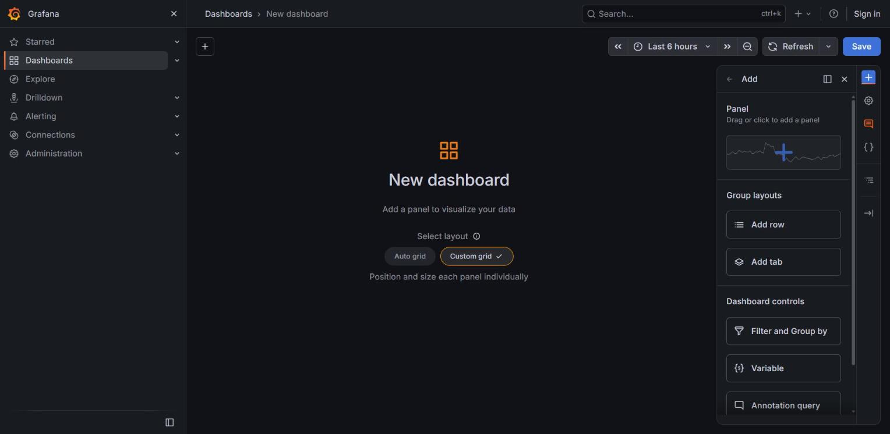

2. On the new panel, click **Configure visualization**.

   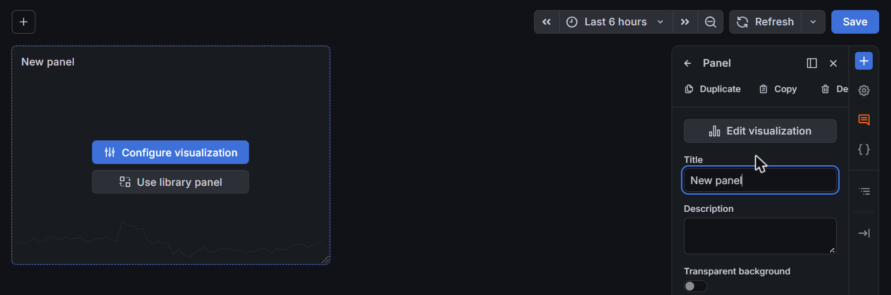

3. **Data source** is already `kafka`. In the query editor:
   - **Topic:** type `telemetri-sungai`, pick it from the list, then click **Fetch**. Nothing is read from Kafka until you click **Fetch**.
   - **Offset:** `Last N messages`, and **N** `500` (recent readings first, then live).
   - Leave the rest: **Partition** `All partitions`, **Message Format** `JSON`.

   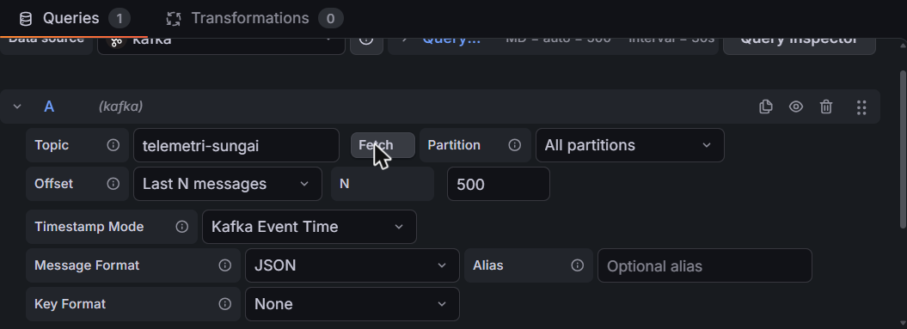

4. At the top, change the time range from **Last 6 hours** to **Last 15 minutes**, so the readings are not squeezed into the right edge.
5. On the right, click **All visualizations → Time series**. A chart appears, but every station is mixed into one line, together with `partition`, `offset` and `hujan`.

   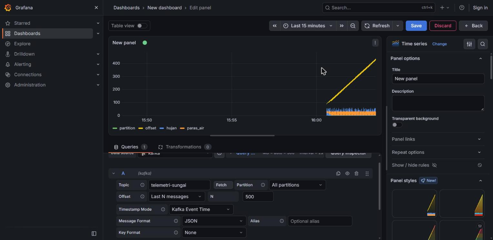

6. Open the **Transformations** tab, click **Add transformation**, search for `Filter fields by name` and click it. In **Identifier** type `time|stesen|paras_air`. Now only `paras_air` is drawn, but still as one zig-zag line through all six stations.

   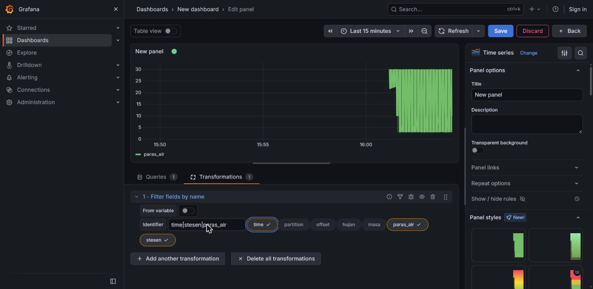

7. Click **Add another transformation**, search for `Partition by values` and click it. Next to **Field**, click **Select field** and choose `stesen`. Now each station has its own line: `paras_air KLT01`, `paras_air PHG01`, …

   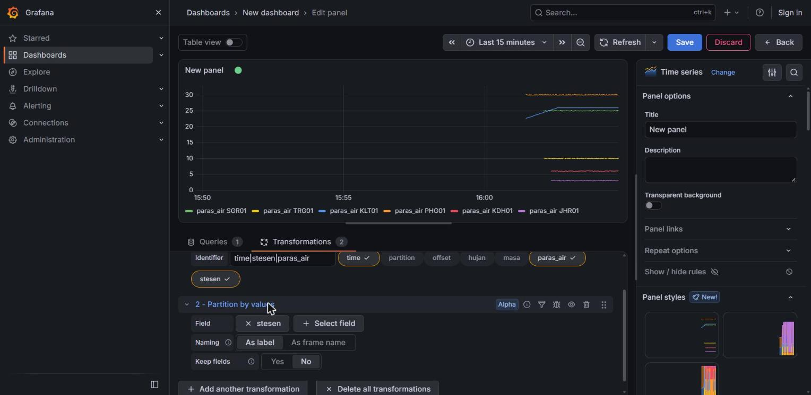

8. In the options on the right, set **Title** to `Paras air (m)`.
9. Click **Save** at the top, set **Title** to `Paras Sungai`, and click **Save**. Then click **Back**. You stay in edit mode.

   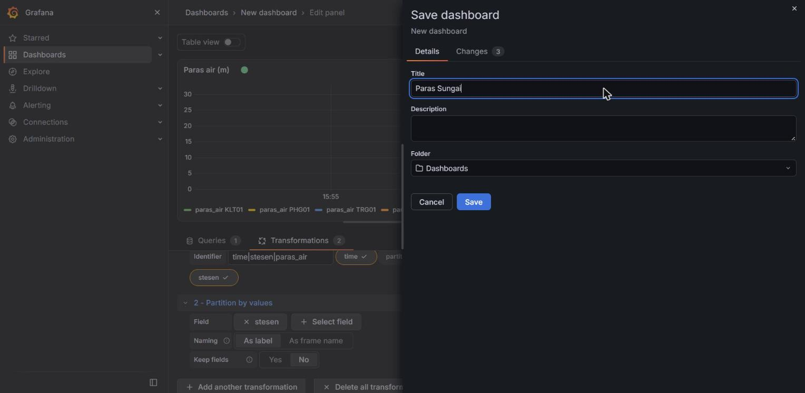

| Setting | Why |
|---|---|
| **Fetch** | Reads the topic's partitions and starts the stream |
| **Last N messages** | Shows recent history at once, then carries on live. N counts per partition, and Grafana keeps only the last few minutes in a live chart, so a bigger N does not show more. Grafana shows a yellow **Potential higher load** note about it; for a lab that is fine. |
| **Filter fields by name** | The plugin turns every number in the message into a series. Keep only the one you want to draw. |
| **Partition by values** | All stations share one topic. This splits the stream into one series per `stesen`. |

### 22.2 — The alerts table

1. Still in edit mode, click **+ Add panel** under the chart (or the blue **+** on the right, then the **Panel** tile), then **Configure visualization**.
2. If the **Transformations** tab is open, click **Queries**. **Topic** `amaran-banjir` (pick it, then **Fetch**), **Offset** `Last N messages`, **N** `20`.
3. **All visualizations → Table**. **Title** `Amaran banjir`.

   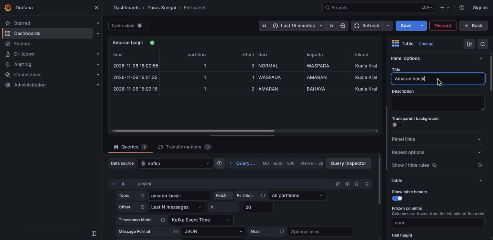

4. **Save**, then **Back**. Drag the panel's corner to make it wide. Click **Exit edit** when you are done.

> **Why not `Earliest` for the alerts?** With `Earliest`, the plugin replays the old alerts only to the first viewer. When you reload the page, the table can stay empty until a new alert arrives. `Last N messages` replays them every time.

> **Stuck?** Import the finished dashboard: open `http://localhost:3000/dashboard/import` and click **Upload dashboard JSON file**. Choose [`code/grafana/paras-sungai.json`](code/grafana/paras-sungai.json), then click **Import**.
>
> 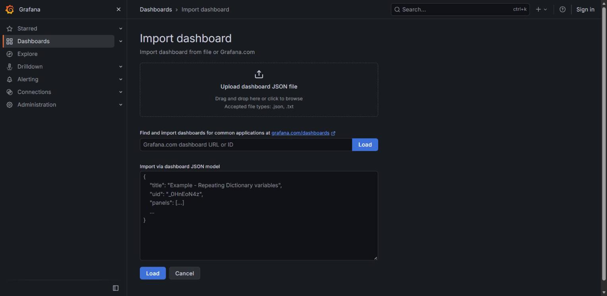
>
> If you already saved a dashboard called **Paras Sungai**, Grafana says `A dashboard or a folder with the same name already exists` and the button reads **Import (Overwrite)**. Change **Name** to `Paras Sungai (siap)` first; the button changes to **Import**.
>
> 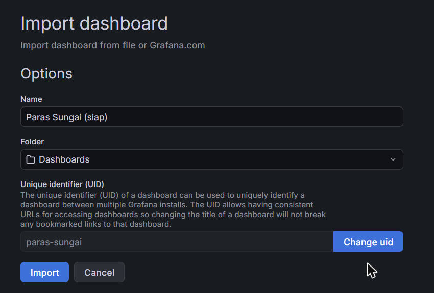

The finished dashboard:

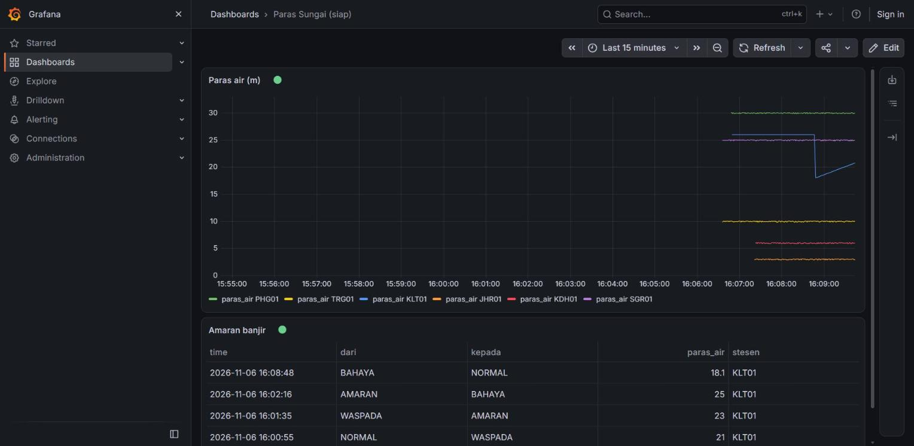

When you restart the simulator, KLT01 starts again from its normal level. `alert.js` sees that as a change and sends a `BAHAYA → NORMAL` alert, as in the picture.

**Try it**
1. Watch the chart while KLT01 floods: its line climbs and flattens just above 25 m. A new alert appears in the table at each status change.
2. Open the dashboard in a **second** browser tab. Both update together.
3. Stop the simulator for 30 seconds, then start it again. The lines stop and continue: the dashboard shows exactly what is in Kafka, live.

**Checkpoint ✅** The **Paras Sungai** dashboard shows six live lines, KLT01 rising, and the KLT01 alerts in the table.

---

## Topic 23 — Reliability, monitoring and security in practice

**Goal:** know what keeps a streaming system healthy after the course: restarts, lag, the usual mistakes, and the basics of securing it.

### 23.1 — Restarts

What you have built survives restarts because of choices made earlier:

| Choice | Where | Why it matters |
|---|---|---|
| Committed offsets | Topic 17 | A restarted consumer continues where it stopped |
| `disconnectOnExit()` on Ctrl+C | Every consumer | The group rebalances at once instead of waiting 30 s |
| Skip bad data instead of crashing | Topics 15, 19 | One bad message cannot stop the stream |
| Alert on change only | Topic 19 | A repeated reading does not send a repeated alert |
| `ON CONFLICT DO NOTHING` | Topic 21 | A replayed reading is not saved twice |
| Retry, do not skip | Topic 21 | A database restart causes a delay, not a gap |
| `restart: unless-stopped` | `docker-compose.yml` | Kafka, the Kafka UI, Grafana and PostgreSQL come back after a Docker restart |

What does **not** survive a restart: `alert.js`'s memory (`lastStatus`). You saw the result in Topic 19: a restart forgets the last status. Production systems keep such state in Kafka itself, for example in a **compacted** topic like Day 1's `status-stesen`, and read it back on start.

In production, a program that stops is restarted automatically by whatever runs it: a process manager such as PM2, a Docker `restart:` policy, or Kubernetes.

### 23.2 — Monitoring: watch the lag

1. In the Kafka UI open **Consumers**. You see every group from today: `group-a` to `group-d`, `alert`, `db-writer` and `notifier`. Day 1's `cli-group` is gone: deleting `telemetri-sungai` this morning removed its offsets. Grafana is not there either: it reads the topic without a group, so it never takes partitions away from anyone.

   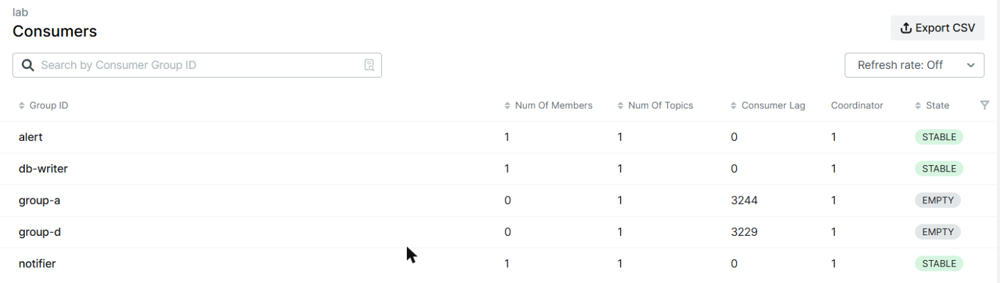

2. Click **alert**: the lag per partition, near 0.
3. Stop `alert.js` for a minute and refresh: the lag grows by about 120 per partition (2 stations per partition, one reading a second). Start it again: back to 0.

The same numbers from the CLI:

```powershell
docker exec kafka /opt/kafka/bin/kafka-consumer-groups.sh --bootstrap-server localhost:9092 --describe --group alert
```

**What to watch in production:**

| Signal | Means |
|---|---|
| Lag **growing** for minutes | Consumers are down or too slow. Add consumers (up to the number of partitions) or fix the slow step. |
| Many `SKIP` lines | A producer is sending bad data. Somebody must look. |
| Consumer group with **no members** | A service has stopped |
| A broker down | Under-replicated partitions in a real cluster (Day 1, Topic 9) |

### 23.3 — Common pitfalls

| Pitfall | Symptom | You saw it in |
|---|---|---|
| Two jobs share one consumer group | Each sees only part of the data | Topic 15 |
| No key, or the wrong key | Readings of one station processed out of order | Topic 16 |
| Throwing on bad data | Consumer stops; restarts stop again (poison message) | Topic 15 |
| Not safe to repeat | Duplicate SMS or database rows after a crash or replay | Topics 17, 20, 21 |
| Skipping on a temporary failure | Readings missing from the database after it restarts | Topic 21 |
| Forgetting `database.on('error')` | A database restart kills the writer | Topic 21 |
| Adding partitions to a keyed topic later | Keys move partition; ordering breaks during the change | Day 1, Topic 13 |
| Auto-create topics left on | A typo creates a new, empty topic | Day 1, Topic 4.3 |

### 23.4 — Security at a glance

Your lab has **no security at all**: anyone who can reach port 9092 can read and write every topic, the Kafka UI and Grafana have no login, and the database password is written in the code. That is fine on your laptop and never fine anywhere else.

| Layer | What it does | In Kafka |
|---|---|---|
| **Encryption** | Nobody on the network can read the data | TLS on the listeners (`SSL://` or `SASL_SSL://` instead of `PLAINTEXT://`) |
| **Authentication** | The broker knows who is connecting | SASL, usually SCRAM-SHA-512 (username + password), or client certificates |
| **Authorisation** | Each user may only do what they need | ACLs, e.g. the notifier may only **read** `amaran-banjir` |

A KafkaJS client for a secured cluster looks like this (not for our lab):

```javascript
const kafka = new Kafka({
  clientId: 'alert',
  brokers: ['kafka-1.example.com:9093'],
  ssl: true,
  sasl: {
    mechanism: 'scram-sha-512',
    username: process.env.KAFKA_USERNAME,
    password: process.env.KAFKA_PASSWORD,
  },
});
```

> **Never** put the password in the code or in Git. Read it from an environment variable or a secrets manager, as above.

**Checkpoint ✅** You can name three things that let your pipeline survive restarts, the number to watch in monitoring, and the three layers of Kafka security.

---

## Topic 24 — Final mini-project: an end-to-end IoT pipeline

**Goal:** run the whole pipeline, prove it survives trouble, and present it.

### 24.1 — Run everything

| Terminal / tab | Command or page | Role |
|---|---|---|
| 1 | `node simulator.js --flood KLT01 --faulty` | Six stations, a flood, one faulty sensor |
| 2 | `node alert.js` | Readings → flood alerts |
| 3 | `node notifier.js` | Flood alerts → SMS |
| 4 | `node db-writer.js` | Readings → PostgreSQL |
| Browser | `http://localhost:3000` → **Paras Sungai** | Live dashboard |
| Browser | `http://localhost:8085` | Kafka UI: topics, messages, groups, lag |

### 24.2 — Prove it works

Tick each one and note the evidence (a screenshot, a number, a log line):

- [ ] The dashboard shows all six stations updating live.
- [ ] KLT01 reaches BAHAYA, and its WASPADA, AMARAN and BAHAYA alerts appear in the dashboard table.
- [ ] The notifier printed two SMS lines (AMARAN and BAHAYA).
- [ ] `alert.js` skipped the faulty KDH01 reading and kept running.
- [ ] PostgreSQL has a row count that keeps growing (the count query from Topic 21).
- [ ] The Kafka UI shows lag near 0 for `alert`, `notifier` and `db-writer`.

### 24.3 — Break it, and prove it survives

Do these one at a time. After each, check the dashboard, the alerts and the lag.

1. **The alert service crashes:** close its terminal with the **trash-can icon**, wait 30 seconds, start it again. Does it catch up? What happens to KLT01's next alert?
2. **Kafka restarts:** `docker compose restart kafka`. What do the simulator and the consumers print? Do they recover by themselves?
3. **The database restarts:** `docker compose restart postgres`. Are any readings missing afterwards? One station sends one reading a second, so this should print about 120:
   ```powershell
   docker exec postgres psql -U kafka -d sungai -c "SELECT count(*) FROM bacaan WHERE stesen = 'SGR01' AND masa > now() - interval '2 minutes';"
   ```
4. **A sensor sends rubbish:** send `bukan json` from the Kafka UI. Which programs notice, and what do they do?
5. **A new service:** without stopping anything, start `node consumer.js group-audit`. It reads the whole history. Why does that not slow down or disturb `alert.js`?

### 24.4 — Present (5 minutes per group)

1. Draw your pipeline: every program, every topic, and which consumer group reads what.
2. Show the numbers: alerts raised, SMS sent, rows in PostgreSQL, lag.
3. One thing you broke, what happened, and why the data was safe.
4. One thing you would add before this went live (security? state kept across restarts? no duplicate SMS?).

**Extra, if you finish early**
1. Make the notifier skip repeats: keep a `Set` of `stesen + masa` it has already sent, and skip an alert that is in it. Reset the `notifier` group to the earliest offset and check that no SMS is sent twice.
2. Add a third Grafana panel: **Topic** `telemetri-sungai`, the same two transformations but with `time|stesen|hujan`, as a **Time series** titled `Hujan (mm)`.

**Checkpoint ✅** Your pipeline runs end to end, survives all five breakages, and you can explain why.

---

## End of Day 2 — what you should have

- The full pipeline: `simulator.js` → `telemetri-sungai` → `alert.js` → `amaran-banjir` → `notifier.js`, every reading saved by `db-writer.js` to PostgreSQL, and a live Grafana dashboard on both topics.
- In `kafka-lab`: `kafka.js`, `stations.js`, `producer.js`, `simulator.js`, `consumer.js`, `alert.js`, `notifier.js`, `db-writer.js`.

**Security recap**
- Kafka, the Kafka UI, Grafana and PostgreSQL have no real security in this lab. Never expose them outside your laptop.
- The database password in `db-writer.js` and `docker-compose.yml` is a lab value. Real passwords come from environment variables or a secrets manager, never from code.

**Clean up** after the course, when you no longer need the data:

```powershell
docker compose down -v
```

`down -v` deletes every container and volume of the course: all topics, messages, database rows and dashboards.

## Command cheat-sheet

| Task | Command |
|---|---|
| Start Kafka + Kafka UI + Grafana + PostgreSQL | `docker compose up -d` |
| Stop everything (keep data) | `docker compose stop` |
| Run a program | `node producer.js` · `node consumer.js [group]` · `node simulator.js [--flood KLT01] [--faulty]` · `node alert.js` · `node notifier.js` · `node db-writer.js` |
| Query the database | `docker exec postgres psql -U kafka -d sungai -c "SELECT …"` |
| Create a topic | `docker exec kafka /opt/kafka/bin/kafka-topics.sh --bootstrap-server localhost:9092 --create --topic <name> --partitions 3` |
| Change a topic's retention | `docker exec kafka /opt/kafka/bin/kafka-configs.sh --bootstrap-server localhost:9092 --alter --entity-type topics --entity-name <name> --add-config retention.ms=<ms>` |
| Lag of a group | `docker exec kafka /opt/kafka/bin/kafka-consumer-groups.sh --bootstrap-server localhost:9092 --describe --group <group>` |
| Reset a group to the start | `docker exec kafka /opt/kafka/bin/kafka-consumer-groups.sh --bootstrap-server localhost:9092 --group <group> --topic <topic> --reset-offsets --to-earliest --execute` |
| Kafka UI / Grafana | `http://localhost:8085` / `http://localhost:3000` |
